# GNOME Remote Desktop on Ubuntu 26.04.1 (Raspberry Pi 4)

**Investigation and reproducibility report — 2026-11-03; revised with native evidence 2026-11-04**  
**Server:** `raspiubuntu401` (Ubuntu 26.04.1, Raspberry Pi 4)  
**Client platforms:** `gmki91` (Gentoo/joetoo, KDE Plasma/KWin X11) and `q552u01` (Gentoo/joetoo, KDE Plasma/KWin Wayland)  
**Destination in joetoo-ai:** `workspace/projects/joetoo-kwin/task_step1.5/`  
**Scope:** GNOME Remote Desktop (GRD) Remote Login and Desktop Sharing; FreeRDP `xfreerdp` and `sdl-freerdp`, KRDC and Remmina; authentication, certificate identity, session lifecycle, display behavior, reboot and implications for `joetoo-kwin`.

> **Evidence convention.** **Verified** refers to maintainer-observed commands, system logs, or supplied screenshots. **Reported** distinguishes a maintainer test result not independently reproduced here. **Likely** is a causal inference consistent with observations. **Not established / NOT TESTED** denotes a remaining question. Client windows visible in screenshots demonstrate usable remote graphics, *not* automatic `joetoo-kwin` registration, certificate-chain verification or remote-login persistence unless those were separately checked. Screenshot links are relative to this Markdown report; files `01`–`17` belong to the original evidence collection, and `18`–`25` are the 2026-11-04 additions.

## Executive summary

**GNOME Remote Desktop worked in both server modes from both Gentoo native test platforms.** The original six combinations—three clients × two GRD modes—passed on `gmki91` X11 and have now also been demonstrated on `q552u01` Wayland. In addition, SDL FreeRDP successfully connected to **Remote Login** from **both** hosts. The maintainer rebooted the Raspberry Pi and confirmed that Remote Login worked again. No replacement server such as `xrdp` was necessary for these Ubuntu cases.

### The two server services are distinct

| Mode | Observed listener | Service scope | Required graphical state | Native outcome |
| --- | --- | --- | --- | --- |
| **Remote Login** | `raspiubuntu401:3389/TCP` | System-level GRD with GDM | Can establish a graphical login remotely; a competing graphical session for `joe` may block login | GDM login and usable GNOME desktop verified; a later successful connection after reboot reported |
| **Desktop Sharing** | `raspiubuntu401:3390/TCP` | `joe`'s user-level GRD | An existing **unlocked local** GNOME desktop for `joe` | Existing local desktop visible and controllable; locks may inhibit/disconnect sharing |

### Client/backend test matrix

| RDP client | `gmki91` X11: Remote Login 3389 | `gmki91` X11: Sharing 3390 | `q552u01` Wayland: Remote Login 3389 | `q552u01` Wayland: Sharing 3390 |
| --- | --- | --- | --- | --- |
| **FreeRDP 3.32.1 — `xfreerdp`** | **PASS** | **PASS** | **PASS** | **PASS** |
| **KRDC 26.04.3** | **PASS** | **PASS** | **PASS** | **PASS** |
| **Remmina 1.4.43** | **PASS** | **PASS** | **PASS** | **PASS** |
| **FreeRDP 3.32.1 — `sdl-freerdp`** | **PASS** | **NOT TESTED** | **PASS** | **NOT TESTED** |

The six `q552u01` combinations and the two SDL tests above are supported by the new evidence in §10. Here **Wayland** identifies the *local KDE Plasma session* on `q552u01`: it does not establish whether each individual client uses a native Wayland surface or XWayland. In particular, the SDL video backend used by `sdl-freerdp` was **not independently recorded**.

**Early blockers were different:** system GRD Remote Login lacked system-scoped RDP credentials; separately, user-level Desktop Sharing lacked correctly configured user-scoped credentials and was subsequently inhibited by an **already-locked physical GNOME desktop**. The remedies were scoped `grdctl` credentials, service restarts, and local unlock—not changes to the RDP client protocol or `joetoo-kwin`.

**Important security qualification:** Current GRD certificates are independent, self-signed, and named `CN=GNOME`; out-of-band fingerprint comparison was used during the original investigation. None of the newly successful client screenshots demonstrates validation against the maintainer's private root/intermediate CA. Certificate issuance/trust integration remains follow-up work.

---

## 1. Server configuration and observed state

### 1.1 GRD architecture

The Pi has **two independent RDP credential contexts and TLS certificate/key pairs**:

- **System Remote Login:** `sudo grdctl --system ...`; systemd **system** service `/usr/libexec/gnome-remote-desktop-daemon --system`; GDM is responsible for graphical user login.
- **User Desktop Sharing:** `grdctl ...` run as `joe`; systemd **user** service `/usr/libexec/gnome-remote-desktop-daemon`; shares the existing user's GNOME/Mutter session.

The RDP connection credential is distinct from the Linux account password. For Remote Login, successful RDP authentication can lead to a further normal GDM graphical login. Even if the same account name `joe` is used in both services, the credential stores are separate. Never commit passwords.

The original investigation observed all relevant services running:

```text
systemctl status gnome-remote-desktop.service
  Active: active (running)
  Exec: /usr/libexec/gnome-remote-desktop-daemon --system

systemctl status gdm.service
  Active: active (running)

systemctl --user status gnome-remote-desktop.service
  user-level GNOME Remote Desktop daemon active
```

`gdm.service` was shown **active** while its unit state was **disabled**. This is not evidence that GDM was absent or malfunctioning; its activation mechanism was not separately investigated.

### 1.2 Observed ports and negotiation

Both `grdctl --system status` and user `grdctl status` reported preferred port 3389, but user GRD had **`Negotiate port: yes`**. The actual listeners showed:

```text
LISTEN ... *:3389 ... gnome-remote-desktop-daemon (system)
LISTEN ... *:3390 ... gnome-remote-desktop-daemon (user)
```

Therefore, on **this configured server**, use **3389 for Remote Login** and **3390 for Desktop Sharing**. Do not infer user GRD's live socket from its preferred-port field. After changes, verify the real binding:

```bash
sudo grdctl --system status
          grdctl status
sudo ss -ltnp | grep -E ':(3389|3390)\b'

# End of commands
```

### 1.3 Credential configuration: the decisive repair

System **Remote Login** credentials, applied on the Ubuntu host:

```bash
sudo grdctl --system rdp set-credentials
# Username: joe
# Password: entered interactively and omitted here
sudo grdctl --system status
sudo systemctl restart gnome-remote-desktop.service

# End of commands
```

User **Desktop Sharing** credentials, applied as local user `joe`:

```bash
grdctl rdp set-credentials
# Username: joe
# Password: entered interactively and omitted here
grdctl status
systemctl --user restart gnome-remote-desktop.service

# End of commands
```

**Do not substitute system-scoped commands for user-scoped commands.** The original error `[RDP] Credentials are not set, denying client` affected system Remote Login; incorrect user-level credentials caused Desktop Sharing's `ERRCONNECT_LOGON_FAILURE`/NTLM `MIC verification failed`. The maintainer restarted both services before successful tests; whether credential reload intrinsically required restarting was **not established**.

GNOME Settings had shown the modes enabled before the system credentials became usable. No evidence established whether the cause was an omitted Save action, Settings persistence defect, or something else; the CLI intervention is the confirmed remedy, **not** proof of a Settings bug.

Some unrelated systemd warnings suggested `daemon-reload` after unit files changed on disk. If needed, use `sudo systemctl daemon-reload` for system units or `systemctl --user daemon-reload` for user units; those warnings did not establish the RDP authentication failure.

### 1.4 Independent certificates and proposed private PKI integration

GRD generated **self-signed** server certificates with `Subject: CN=GNOME, C=US` and the same issuer. They did not match the contacted hostname `raspiubuntu401` and were not issued from the maintainer's private CA.

| Mode | Observed certificate file | Observed SHA-256 fingerprint |
| --- | --- | --- |
| Remote Login | `/var/lib/gnome-remote-desktop/.local/share/gnome-remote-desktop/certificates/rdp-tls.crt` | `ee:a7:3c:a3:3b:a9:ec:f5:25:8f:df:76:bb:05:32:8c:15:73:bd:50:57:76:0d:c5:69:c7:69:08:2d:58:93:d9` |
| Desktop Sharing | `/home/joe/.local/share/gnome-remote-desktop/certificates/rdp-tls.crt` | `41:a3:aa:66:f9:f4:e0:16:40:84:ec:f0:6b:87:e6:ae:31:90:fe:dd:7e:c9:fd:95:66:bd:0f:98:c2:c4:05:fd` |

Their corresponding private key files have the same basenames ending in `rdp-tls.key`; **never copy them into Git or the evidence bundle**. These fingerprints are installation-specific and may change on renewal/reinstallation.

Read-only server-side fingerprint comparison:

```bash
sudo openssl x509 \
  -in /var/lib/gnome-remote-desktop/.local/share/gnome-remote-desktop/certificates/rdp-tls.crt \
  -noout -subject -issuer -dates -fingerprint -sha256

# End of commands
```

In the original FreeRDP certificate prompt, **Y** accepted/persisted trust, **T** temporarily trusted, and **N** refused. Both server modes' certificate fingerprints were compared out-of-band before acceptance. The **new X11 and Wayland screenshots are not evidence of an independently issued/trusted certificate chain**, and the SDL terminal screenshots still show certificate-verification warnings.

A proposed follow-up is to issue **separate, correctly named RDP server certificates** through the existing root/intermediate CA workflows, with appropriate hostname/IP SANs and server authentication use. Configure the correct cert/key through system and user `grdctl rdp set-tls-cert` and `set-tls-key`, with key permissions that permit the intended daemon to read the key, and distribute the private CA chain to clients. Test hostname and chain verification **independently on 3389 and 3390**. This was **not done** in the present study.

The Pi also emitted `Init TPM credentials failed because No TPM device found, using GKeyFile as fallback.` This did not prevent either RDP service from functioning.

### 1.5 Other nonfatal log observations

During the original investigation, GRD emitted missing `libcuda.so.1`/`libnvidia-encode.so.1` messages while reporting successful Vulkan initialization and RDP startup; this Raspberry Pi has no NVIDIA GPU. These were not shown to cause authentication or remote-session failures. SSH connectivity to the Pi was functioning independently.

---

## 2. FreeRDP `xfreerdp` — command-line baseline

**Installed:** `net-misc/freerdp-3.32.1` with `client`, `X` and other USE features; `-aad`. On the tested Gentoo system, the executable is `/usr/bin/xfreerdp` rather than `xfreerdp3`.

```bash
# GNOME Remote Login
xfreerdp /v:raspiubuntu401:3389 /u:joe /network:auto /dynamic-resolution

# GNOME Desktop Sharing
xfreerdp /v:raspiubuntu401:3390 /u:joe /network:auto /dynamic-resolution

# End of commands
```

For these GNOME connections, leave the RDP **Domain** prompt blank; it is not the `.brendler` DNS suffix. Supply the GRD mode's corresponding password interactively. **Do not use** `/v:joe@raspiubuntu401:3389`: `/v:` expects a host/port, and that input previously failed DNS lookup. `/u:joe` supplies the account name.

The warning `[nego_enable_aad]: This build does not support AAD security, disabling` is not a reason to rebuild with Gentoo USE `aad`: these GNOME local credentials do not require Azure/Entra authentication. Observed XKB-keycode and clipboard `CB_RESPONSE_FAIL` warnings were nonfatal. **Plain-text clipboard worked in both directions** in the original tests of both modes, but arbitrary MIME formats and file copying were not proven.

Original X11 evidence:

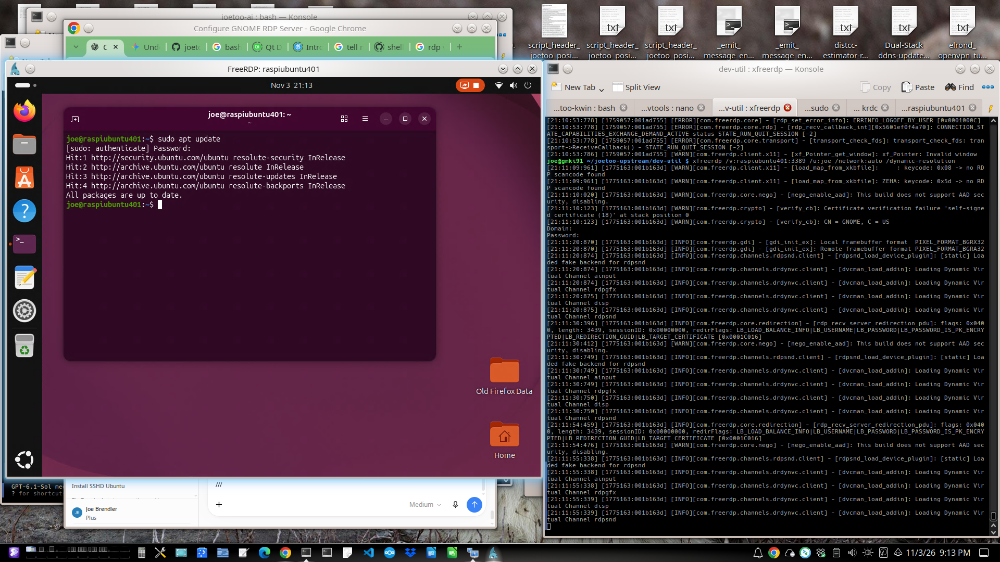

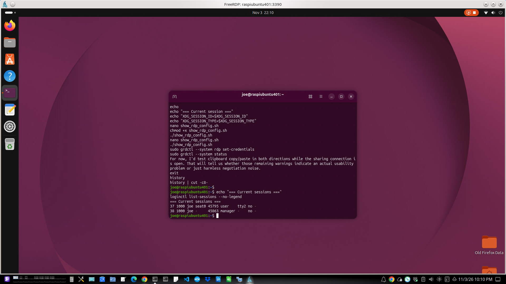

**New `q552u01` Wayland evidence** (working remote-session windows, not yet managed by `joetoo-kwin`):

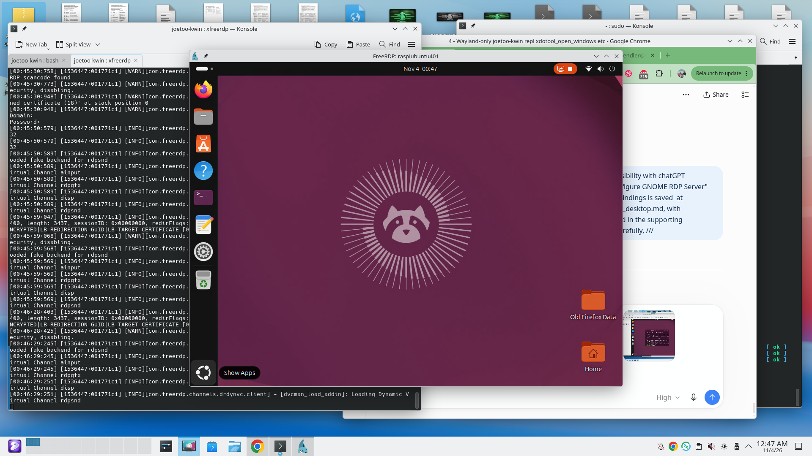

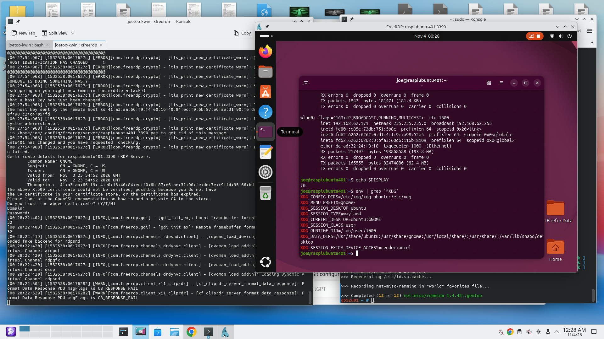

The sharing screenshot includes a FreeRDP warning that the host/certificate identity changed and a trust prompt for the current self-signed certificate. The visible desktop shows connection success, **not** that future connections will pass strict PKI validation.

---

## 3. KRDC — KDE graphical client

**Installed on original host:** `kde-apps/krdc-26.04.3` with `rdp`, `ssh`, `vnc`, `wayland`; `krdc_rdpplugin.so` was present and loaded. This **KRDC client** is unrelated to the `kde-plasma/krdp` server component installed elsewhere in the feasibility investigation.

Known-good launch forms:

```bash
krdc 'rdp://joe@raspiubuntu401:3389'  # Remote Login
krdc 'rdp://joe@raspiubuntu401:3390'  # Desktop Sharing

# End of commands
```

An earlier attempt in KRDC's GUI produced **Malformed URL** and a `rdp%3A%2F%2F...` double-encoded URL; the explicit, quoted URI above avoided that ambiguity.

### 3.1 Working local Host Configuration

| KRDC configuration | Original working evidence |
| --- | --- |
| **General** | Resolution **Current Window Size**, acceleration **Use Best Available**, device scale **Auto**, keyboard **US English**, audio **On This Computer**; a default `Share Media` path `file:///media` was not proven valid |
| **Security** | **NLA on, TLS on, RDP on, Ext off**, **TLS security level 192 bit**, Authentication Package List blank; NLA-only with 192 bit also worked in the original trial |
| **Proxy** | HTTP dropdown at default; no server/credentials entered |
| **Gateway** | Transport Auto; server/domain/credentials blank |
| **SSH tunnel** | Disabled |

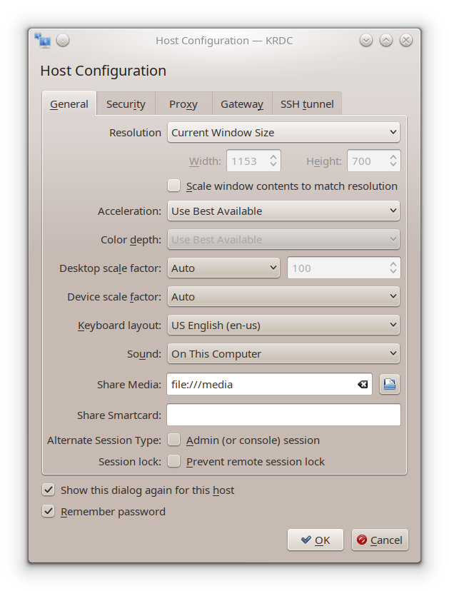

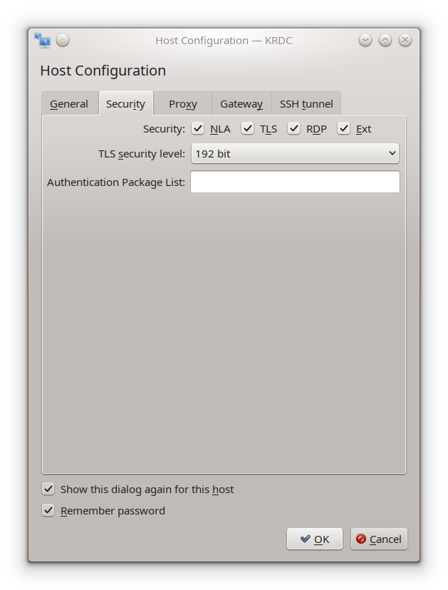

**Historical screenshot caveat:** `06-krdc-security-settings.png` showed all **four** security boxes selected, though the final working choice was NLA + TLS + RDP, **Ext off**. The image supports the **192-bit setting**, not the final exact checkbox set.

### 3.2 Negotiation observations and limits

- **TLS-only with NLA unchecked** failed with `ERRCONNECT_HYBRID_REQUIRED_BY_SERVER`; GNOME required NLA for this setup.
- **NLA-only at the KRDC 192-bit setting** worked, but NLA/CredSSP is itself TLS-based. “192 bit” is a KRDC security-level setting, **not** the measured TLS cipher's key length.
- **NLA + TLS + RDP at 192 bit** also worked. Earlier 256-bit attempts failed; the underlying cryptographic or configuration cause was **not established**.
- A KRDC GUI checkbox permitting classic RDP is **not evidence that classic RDP security was negotiated**. A production `joetoo-kwin` recipe should establish a verified, no-unsafe-downgrade negotiation policy before unattended use.
- `QtKeychain`/KWallet error and `file:///media` redirection warnings were observed, but not proven causal.

Original evidence:

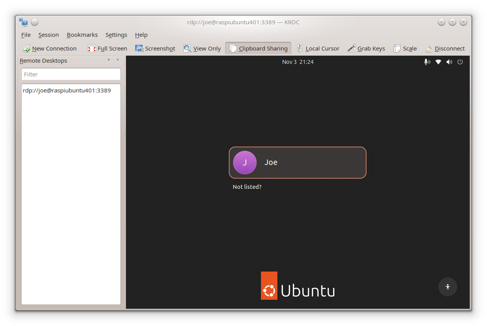

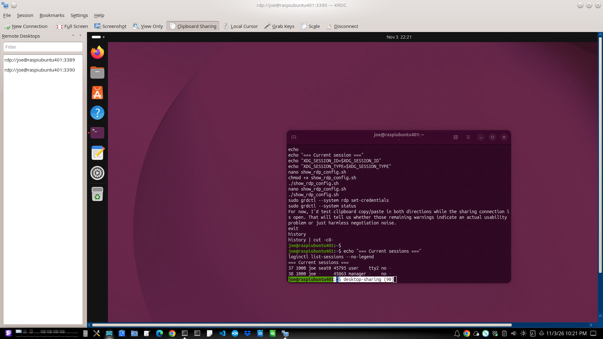

**New `q552u01` Wayland evidence:**

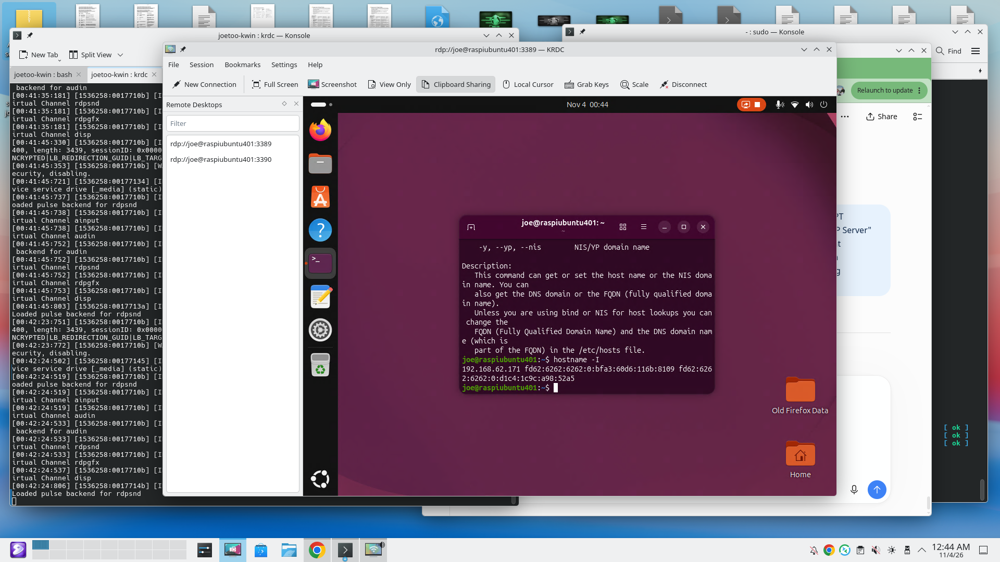

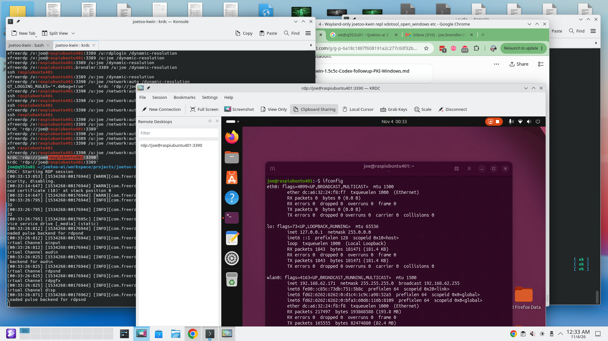

The existing physical desktop was about 1920×1080; inside KRDC's toolbar/sidebar view, use **Full Screen** or client scaling rather than assuming a cropped display is a connection failure.

---

## 4. Remmina — profile-based graphical client

**Installed:** `net-misc/remmina-1.4.43` with RDP support. The working flow was to create/edit a saved profile with `+`, **Save and Connect**, and subsequently open its row (including right-click **Connect**). Remmina is a **client**; the saved profile is not itself a separate remote server.

### 4.1 Original working profiles

| Field | Remote Login | Desktop Sharing |
| --- | --- | --- |
| Name | `Quick Connect - raspiubuntu401 remote login` (later renamed) | `Quick Connect - raspiubuntu401 shared desktop` (later renamed) |
| Protocol | RDP | RDP |
| Server | `raspiubuntu401:3389` | `raspiubuntu401:3390` |
| Username | `joe` | `joe` |
| Password | System-level GRD credential | User-level GRD credential |
| Domain / share folder | **blank** | **blank** |
| Security protocol negotiation | Automatic negotiation | Automatic negotiation |
| TLS Security Level | Default | Default |
| Quality | Initially Poor/Fastest, later Best tried | Later Good |
| Audio output | Off | Off |
| SSH tunnel | Off | Off |

The Advanced page showed an **HTTP gateway-transport dropdown** with *no gateway server configured*. This does **not** establish use of an HTTP proxy or Remote Desktop Gateway. **Do not copy KRDC's 192-bit setting into Remmina**: Remmina passed at its own default setting.

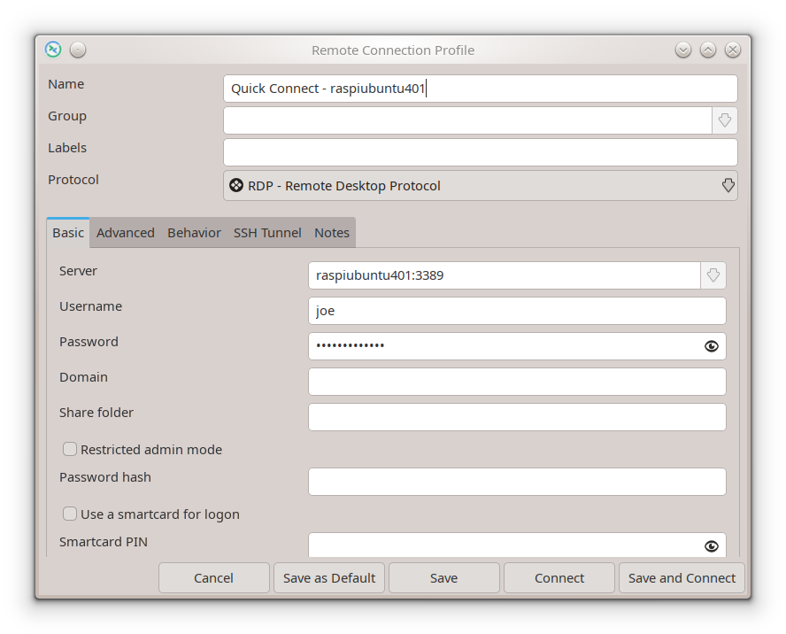

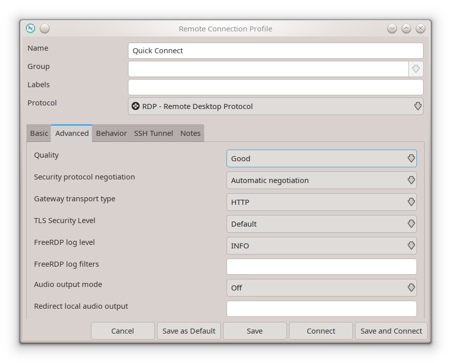

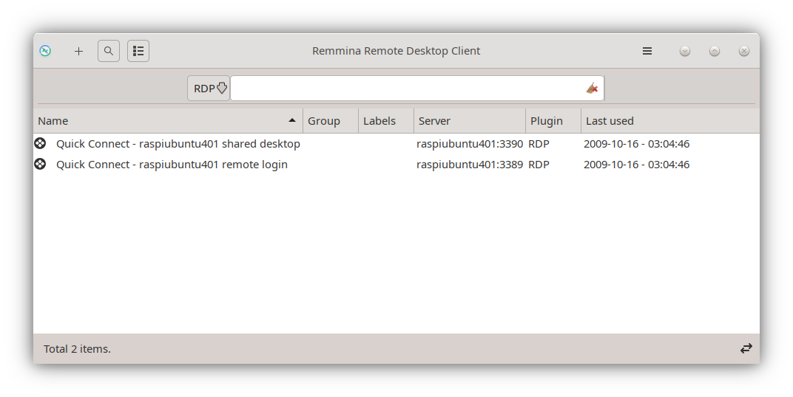

### 4.2 Connection and session evidence

Remmina Remote Login initially displayed a transient white/blank view for about ten seconds before reaching GDM and a usable remote GNOME desktop. After deliberately disconnecting **without logging out**, a later Remote Login reconnection resumed the same graphical session. **Session persistence through client disconnect** was therefore verified in the original trials; this does not mean a remote session survives a **server reboot**.

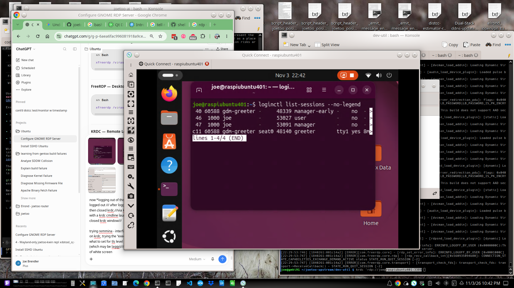

On 3390, Remmina prompted for a **different sharing certificate**, whose fingerprint matched the user GRD certificate in §1.4.

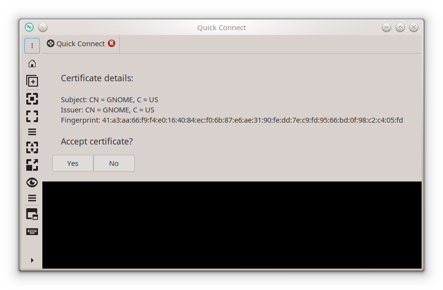

An attempted sharing connection while an active, disconnected Remote Login session still existed could not establish the physical sharing target:

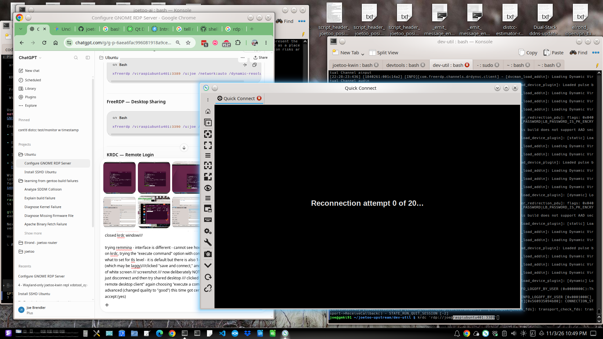

After explicitly logging out of remote GNOME, logging into `joe` locally and leaving GNOME unlocked, sharing worked:

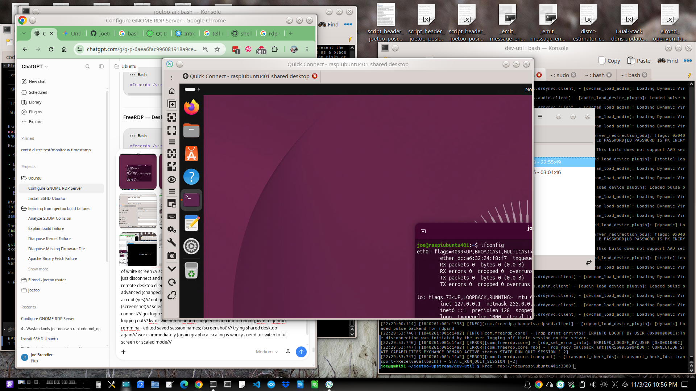

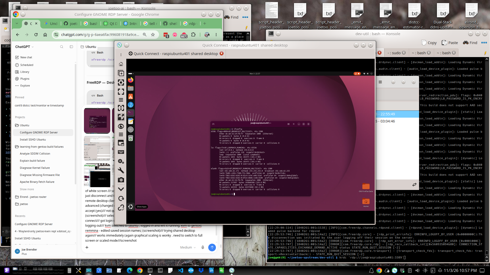

The full-size physical desktop can be cropped inside a smaller viewer. Remmina's **scale-to-window** and full-screen settings are viewing conveniences, not server-side GNOME authentication changes. Quality presets were tried but no controlled bandwidth, latency or CPU comparison was performed.

**New `q552u01` Wayland evidence:**

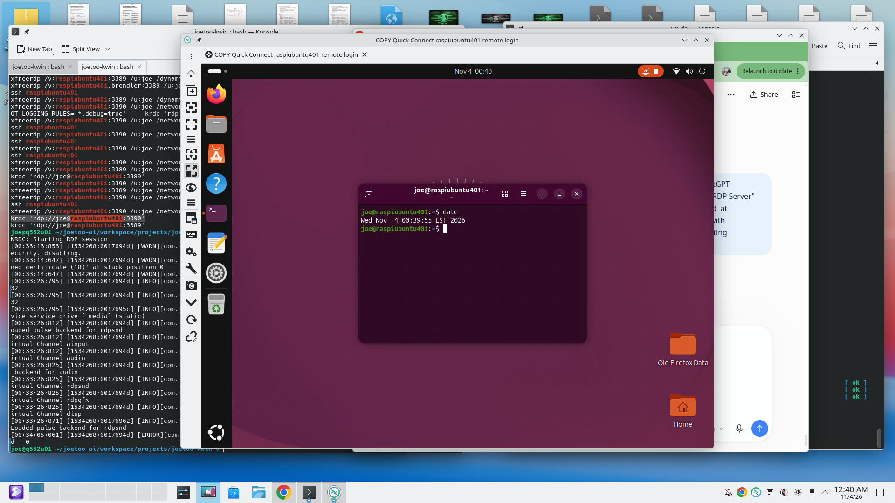

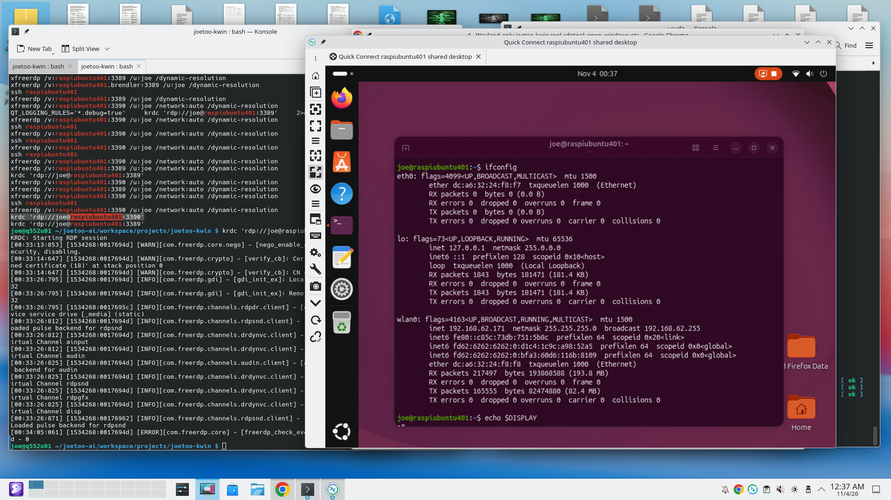

---

## 5. SDL FreeRDP — additional cross-backend Remote Login result

FreeRDP 3.32.1 with SDL support provides the installed `sdl-freerdp` frontend. The maintainer tested the following **same command** on **both** `gmki91` X11 and `q552u01` Wayland:

```bash
sdl-freerdp /v:raspiubuntu401:3389 /u:joe /network:auto /dynamic-resolution

# End of commands
```

Both tests produced a visible, usable GNOME Remote Login desktop:

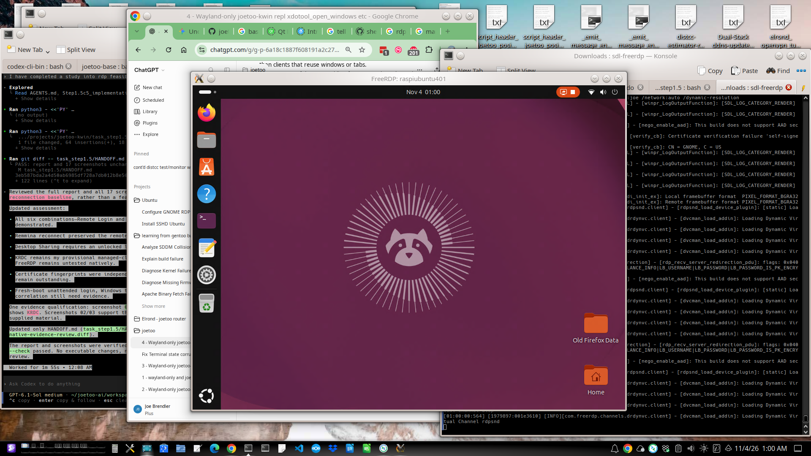

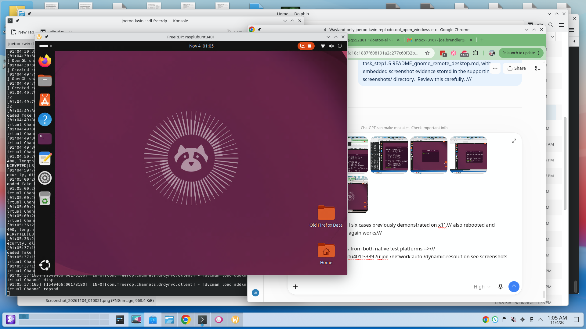

**What this establishes:** SDL FreeRDP can serve as a working graphical RDP *client* when invoked from either of the joetoo native test desktop environments. This is important because Gentoo explicitly masks `>=net-misc/freerdp-3 wayland` in `profiles/base/package.use.mask` due to the older upstream Wayland frontend. That mask does **not** disable the independently built SDL frontend or prevent an X11 client from running under XWayland.

**What remains open:** The screenshots do **not** identify the actual SDL video driver or prove the SDL window was native Wayland rather than XWayland. They also do **not** establish a working `sdl-freerdp` **Desktop Sharing 3390** case, exact PID→KWin UUID registration, managed placement, credential-prompt ownership, or the security of automatic certificate acceptance. The SDL command line shown includes no password; the visible terminal logs still include certificate verification warnings for a self-signed GNOME certificate. PKI trust and frontend dialog behavior require explicit review before automated integration.

---

## 6. GNOME session lifecycle and operational limitations

### 6.1 Do not conflate remote viewer and GNOME session state

- **Disconnect or close RDP viewer:** ends that connection. A GNOME **Remote Login** user session may remain alive and be reconnected to; Remmina reconnection verified this on the tested server.
- **Log Out inside GNOME:** terminates the graphical login session. A viewer attached to it disconnects because the remote desktop has ended.
- **Lock existing local GNOME desktop:** in the observed setup, **Desktop Sharing** connections were inhibited or disconnected until the physical session was unlocked locally.
- **Attempt Remote Login as `joe` when `joe` is already graphically logged in:** GNOME/GDM may report **Session Already Running** and offer **Cancel** or **Force Stop**. Force Stop risks terminating an existing user session and unsaved work. It must not be automated casually.

**Switching Remote Login → Desktop Sharing:** save work, log out of the remote GNOME session (do **not** just close the client), log in locally as `joe`, leave the desktop unlocked, then connect to `3390` using user-scoped GRD credentials.

**Switching Desktop Sharing → Remote Login:** save work and log out of the local GNOME session when appropriate, then connect to `3389` using system-scoped GRD credentials and complete GDM login. During initialization a gray/charcoal or blank screen may appear transiently; one attempt stayed dark and was closed, another reached the GNOME desktop after ~10 seconds. A persistent blank screen is not a successful session.

**Preserve a Remote Login session temporarily:** close only the viewer; reconnect later to `3389`. The disconnected graphical `joe` session may continue to prevent a competing local `joe` login.

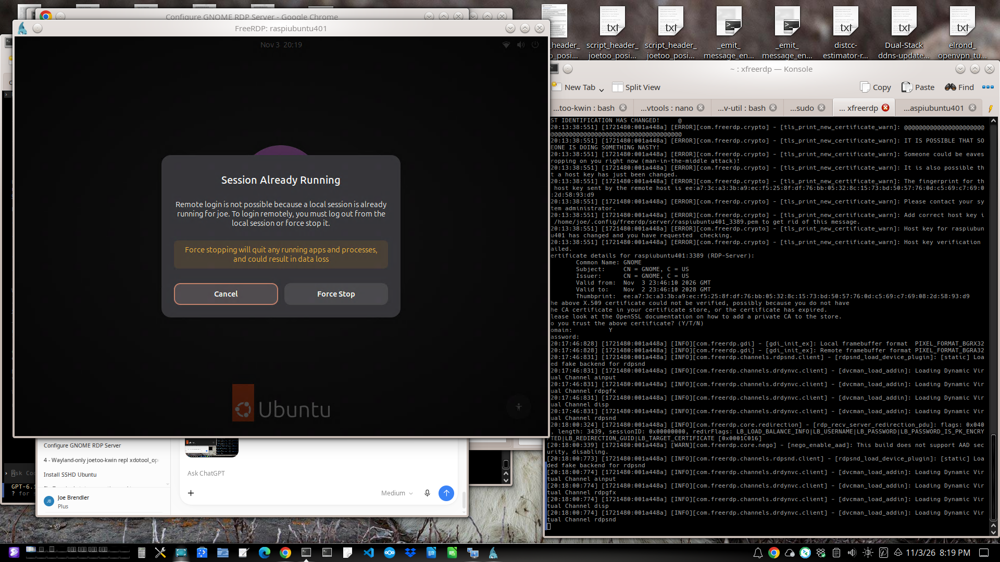

### 6.2 Screen-lock inhibition and later viewer disappearance

One early 3390 attempt authenticated far enough to establish graphics channels, then terminated with `ERRINFO_LOGOFF_BY_USER (0x0000000C)`. The contemporaneous **server** journal was more diagnostic:

```text
Failed to start remote desktop session:
GDBus.Error:org.freedesktop.DBus.Error.Failed: Session creation inhibited
... ERRINFO_RPC_INITIATED_DISCONNECT [0x00010001]
```

After using the local KVM to **unlock** GNOME, Desktop Sharing worked. That supports the lock explanation strongly, though the specific lock event timestamp was not independently captured.

A later Remmina shared-desktop viewer closed with Plasma's configured “explode” animation. This was **likely** another inactivity-lock event, but no matching server journal for that specific disappearance was saved. The animation itself is not evidence of a Remmina graphics crash.

### 6.3 `loginctl` session accounting

A captured `loginctl list-sessions` output contained an SSH session, a `joe` systemd user manager, GDM greeter entries, and a single remote Wayland graphical session for `joe`. An inspected remote graphical session showed `Service=gdm-password`, `Type=wayland`, `Remote=yes`, a nonblank `RemoteHost`, and `State=active`.

**Do not infer two graphical logins merely from multiple `loginctl` rows.** Session IDs are ephemeral; do not hardcode values into scripts. Useful diagnostics:

```bash
loginctl list-sessions
loginctl show-session SESSION_ID \
  -p Name -p Type -p Class -p Service -p Remote -p RemoteHost \
  -p State -p Active -p TTY -p Leader
who -a
systemd-inhibit --list
ps -eo pid,ppid,user,tty,stat,etime,args --forest | \
  grep -E 'gnome-shell|gnome-session|gdm|gnome-remote-desktop|Xwayland|sshd|systemd --user'

# End of commands
```

A previously refused reboot was associated with other-session warnings, but the exact blocker was **not established**. Avoid indiscriminate `loginctl terminate-user joe`, Force Stop, or forced reboot while work may be unsaved.

### 6.4 New post-reboot observation (2026-11-04)

The maintainer **rebooted `raspiubuntu401` and successfully connected by Remote Login again**. This supersedes the original report's suggestion that Remote Login *had not been tried at all* after a reboot. It demonstrates post-reboot service usability, **not** survival of an existing GNOME user session through reboot. The supplied statement does not independently establish whether that Remote Login occurred before any local user login, nor whether both sockets and Desktop Sharing were rechecked after boot. Those remain narrower follow-up questions, not grounds to repeat the six already completed client/mode tests.

---

## 7. Troubleshooting reference and corrected interpretations

| Observation | Established cause or qualified interpretation |
| --- | --- |
| `xfreerdp3: command not found` | FreeRDP 3.32.1 on this Gentoo host installs `xfreerdp`. |
| TCP reset on 3389 while system GRD said enabled | System journal: `[RDP] Credentials are not set, denying client`; set **system** RDP credentials. |
| Trying `/u:rdplogin` | That was not the configured name; the configured RDP username was `joe`. |
| `/v:joe@raspiubuntu401:3389` | Invalid FreeRDP host argument for these tests; pass `/v:raspiubuntu401:3389 /u:joe`. |
| Self-signed or changed host certificate warning | GRD uses separate original self-signed certificates; compare the actual server fingerprint before any trust decision. PKI validation not established. |
| Desktop Sharing `ERRCONNECT_LOGON_FAILURE`, NTLM `MIC verification failed` | User GRD credentials incorrectly set in the system scope; corrected with user-scoped `grdctl`. |
| Sharing viewer appears then closes | Server `Session creation inhibited` and unlock-then-success support local screen lock as cause. |
| Entering `.brendler` as RDP Domain | DNS suffix is not the RDP auth domain; leave blank here. |
| KRDC malformed URL | GUI encoded URI scheme into address; use `krdc 'rdp://joe@host:port'`. |
| KRDC TLS-only, NLA off | Server rejected negotiation with `ERRCONNECT_HYBRID_REQUIRED_BY_SERVER`. |
| KRDC 256-bit level failure then 192-bit success | Verified configuration difference; exact negotiated cipher/cause undetermined. |
| KRDC KWallet/QtKeychain or `file:///media` warning | Observed but not proven to cause auth failures. |
| Remmina shared-desktop retry while remote `joe` session persisted | Remote session and local shareable user session conflicted; logging out remote GNOME cleared the workflow. |
| Initial blank Remmina window | Approximately ten-second startup delay before usable GNOME; not necessarily failure. |
| 1920×1080 desktop cropped by viewer | Client scaling/full-screen presentation issue, not GRD auth failure. |
| FreeRDP `-aad` or XKB warnings, clipboard `CB_RESPONSE_FAIL` | Nonfatal in the original tests; ordinary text clipboard was bidirectional. |
| `ERRINFO_LOGOFF_BY_USER` | Protocol reason, not proof a human chose Log Out; cross-check server journal. |
| FreeRDP 3 `(-wayland)` | Confirmed Gentoo base-profile package USE mask of deprecated old client frontend; **not** proof that `xfreerdp` or `sdl-freerdp` fails in a Wayland Plasma session. |
| SDL FreeRDP TLS verification warning despite visible desktop | Working graphics is not authenticated certificate-chain verification; evaluate the actual trust decision and negotiated policy separately. |

### Read-only server diagnostics

```bash
# Listeners and two independent configuration scopes
sudo ss -ltnp | grep -E ':(3389|3390)\b'
sudo grdctl --system status
grdctl status

# System-level Remote Login
systemctl status gnome-remote-desktop.service --no-pager -l
sudo journalctl -b -u gnome-remote-desktop.service -n 60 --no-pager -l

# User-level Desktop Sharing
systemctl --user status gnome-remote-desktop.service --no-pager -l
journalctl --user -b -u gnome-remote-desktop.service -n 60 --no-pager -l

# GDM and graphical session state
systemctl status gdm.service --no-pager -l
loginctl list-sessions

# End of commands
```

For a specific failure, use corresponding timestamps in both client and server logs, changing one variable at a time:

```bash
journalctl --user -b -u gnome-remote-desktop.service \
  --since '2026-11-03 20:50:00' --until '2026-11-03 20:51:00' \
  --no-pager -l

# End of commands
```

---

## 8. Implications for `joetoo-kwin` Step 1.5c.5c

**Subsequent milestone decision (2026-11-05):** the maintainer closed 1.5c.5c
with affirmative feasibility after the SDL identity investigations recorded in
[HANDOFF.md](HANDOFF.md), including native-Wayland negative/coexistence tests.
The study below retains its original evidence boundaries. Step 1.5c.5d is the
next managed RDP milestone, with SDL first by implementation sequence; accepted
TigerVNC and future separately approved RDP clients are user-selectable peers.
No executable increment is authorized by this documentation update.

This study establishes a **working RDP server/client interoperability baseline on both joetoo native test platforms**, but it does **not** itself implement a managed RDP launch recipe in `joetoo-kwin`.

1. **Viewer lifecycle ≠ GNOME login-session lifecycle.** Closing the local viewer might preserve a Remote Login GNOME session; never equate closing a window, disconnecting TCP and logging out remotely.
2. **Server responsibilities remain external.** GRD configuration, GDM login policy, local console locks, credential stores, TLS certificates and host firewall are prerequisites managed independently. `joetoo-kwin` should initially manage only local client launch, positive KWin window identity, desktop/slot/geometry/layer placement, and truthful launch/transport reporting.
3. **Credentials and server identity are independent of window placement.** System Remote Login and user Desktop Sharing require separate RDP credentials and certificates. Never commit passwords or automatically waive certificate warnings in an unattended invocation.
4. **Native backend support is now demonstrated at the GUI interoperability level.** `xfreerdp`, KRDC and Remmina were all manually observed in both server modes under KDE X11 and KDE Wayland; SDL FreeRDP remotely logged in from both. This is sufficient to consider them *pilot candidates*, not to assert exact KWin UUID enrollment or whether SDL used native Wayland versus XWayland.
5. **Protocol/client security remains a gate.** Determine the actual negotiated NLA/TLS behavior, certificate chain/name validation, downgrade handling and credential UI. A checked GUI option or successful remote desktop alone does not establish a verified cryptographic policy.
6. **Positive desktop-window identity must be proved before integration.** Authentication dialogs, saved-profile delegation and potential reuse of a single client process require targeted PID/UUID testing. We cannot automatically repurpose the TigerVNC enrollment assumptions.
7. **Display policy is client- and server-mode-dependent.** Remote Login can use virtual dimensions/dynamic resolution; physical Desktop Sharing mirrors an already running display. Neither should silently override the joetoo shared geometry or initial placement contract.
8. **Failure classification should remain specific.** GNOME lock, expired/changed TLS cert, missing credentials, ongoing remote session, transient black screen and graphical client exit are distinct conditions. Keep logs visible rather than converting every failure into “window launch failed.”
9. **Preserve the accepted VNC-over-SSH path.** It remains a separate working baseline; this study establishes RDP feasibility rather than acceptance of a replacement implementation.

These GNOME/GDM observations should **not** be assumed to describe a Gentoo `krdpserver`, `xrdp`, SDDM, or Windows RDP server without separate evidence. Windows remote login/attended-sharing remains an explicit future evaluation target, not a result of the Ubuntu tests.

## 9. Remaining work and evidence limitations

- **Server reboot:** Remote Login was successfully re-established after reboot (**now verified**). The exact first-login sequence before any local console login, post-boot listener inventory, and Desktop Sharing after that same reboot were **not separately documented**.
- **Certificate policy:** Replace the two self-signed certificates with SAN-correct certificates from the maintainer's existing PKI, then verify trust chains, hostname matching and any pinning behavior in KRDC, Remmina and FreeRDP (system and user listeners separately). **Not yet done**.
- **Negotiated RDP security:** Determine actual TLS cipher/protocol and NLA or downgrade behavior, particularly KRDC's 192-bit setting. Do not infer cryptographic strength from a UI label.
- **SDL frontend:** Subsequent native evidence confirmed SDL's `wayland` backend on `q552u01` and the marker/PID/UUID viewer distinction, including cancellation, failed NLA, connection failure and unrelated-viewer coexistence; see HANDOFF iterations 40–44. Production certificate behavior remains unverified; optional SDL Desktop Sharing (3390) remains a separate, untested capability.
- **Managed client pilot:** Verify exact KWin PID/UUID identity, authentication pre-window, desktop/slot/geometry/stack, window reuse, cancellation and exit for selected RDP clients. **No such `joetoo-kwin` RDP integration tests were performed.**
- **Lock behavior:** Correlate an actual GNOME inactivity lock with journal timestamps. Earlier `Session creation inhibited` evidence is strong; a later spontaneous Remmina close remained inferred.
- **Performance and peripheral features:** No controlled latency, CPU/network, codec or audio redirection benchmarks. Plain-text clipboard was originally tested in both directions; file transfers and arbitrary MIME types were not established.
- **Windows server:** Windows RDP host capability, local console semantics, certificates and remote login/attended sharing have **not** been tested in this Ubuntu study.
- **Access policy:** No firewall-rule modification was documented. Keep RDP limited to approved LAN/VPN exposure; no unreviewed public Internet forwarding.
- **Client versions:** The documented investigation used FreeRDP 3.32.1, KRDC 26.04.3 and Remmina 1.4.43. Recheck versions and settings if updating the packages.

## 10. Screenshot evidence index

Original collection files `01`–`17` are retained as-is. The new `18`–`25` files are supplied in the accompanying evidence bundle and should be placed in the same `task_step1.5/screenshots/` directory. Screenshots may depict intermediate settings or nonfatal diagnostics; source-specific written working configurations take precedence.

| Relative screenshot path | What it establishes |
| --- | --- |
| `screenshots/01-freerdp-remote-login-gdm.png` | Initial X11 FreeRDP/GDM login |
| `screenshots/02-freerdp-remote-login-session.png` | Original X11 FreeRDP Remote Login GNOME desktop |
| `screenshots/03-freerdp-desktop-sharing.png` | Original X11 FreeRDP Desktop Sharing |
| `screenshots/04-krdc-remote-login.png` | Original X11 KRDC GDM login |
| `screenshots/05-krdc-general-settings.png` | Original KRDC General settings |
| `screenshots/06-krdc-security-settings.png` | KRDC 192-bit security setting; interim all-four-boxes screenshot |
| `screenshots/07-krdc-desktop-sharing.png` | Original X11 KRDC Desktop Sharing |
| `screenshots/08-remmina-profile-basic.png` | Remmina Basic settings |
| `screenshots/09-remmina-profile-advanced.png` | Remmina Advanced settings |
| `screenshots/10-remmina-remote-login.png` | Original X11 Remmina Remote Login |
| `screenshots/11-remmina-cert-3390.png` | Remmina user GRD certificate prompt |
| `screenshots/12-remmina-connection-retry.png` | Remmina sharing connection retry/failure |
| `screenshots/13-remmina-saved-profiles.png` | Two separate Remmina RDP profiles |
| `screenshots/14-remmina-desktop-sharing-window.png` | Original X11 Remmina sharing at physical resolution |
| `screenshots/15-remmina-desktop-sharing-scaled.png` | Original X11 Remmina scaled sharing view |
| `screenshots/16-freerdp-session-already-running.png` | GDM session conflict/Force Stop warning |
| `screenshots/17-krdc-initial-malformed-url.png` | Earlier KRDC URI parsing failure |
| `screenshots/18-wayland-xfreerdp-desktop-sharing.png` | **NEW:** `q552u01` Wayland, `xfreerdp`, Desktop Sharing port 3390; visible cert warning |
| `screenshots/19-wayland-krdc-desktop-sharing.png` | **NEW:** `q552u01` Wayland, KRDC, Desktop Sharing 3390 |
| `screenshots/20-wayland-remmina-desktop-sharing.png` | **NEW:** `q552u01` Wayland, Remmina, Desktop Sharing 3390 |
| `screenshots/21-wayland-remmina-remote-login.png` | **NEW:** `q552u01` Wayland, Remmina, Remote Login 3389 |
| `screenshots/22-wayland-krdc-remote-login.png` | **NEW:** `q552u01` Wayland, KRDC, Remote Login 3389 |
| `screenshots/23-wayland-xfreerdp-remote-login.png` | **NEW:** `q552u01` Wayland, `xfreerdp`, Remote Login 3389 |
| `screenshots/24-x11-sdl-freerdp-remote-login.png` | **NEW:** `gmki91` X11, `sdl-freerdp`, Remote Login 3389 |
| `screenshots/25-wayland-sdl-freerdp-remote-login.png` | **NEW:** `q552u01` Wayland, `sdl-freerdp`, Remote Login 3389 |

---

**Updated conclusion (2026-11-04):** The GRD server's two independent service modes, credentials and certificates were established; three GUI clients worked in both modes on **each** joetoo KWin test backend; SDL FreeRDP additionally worked for Remote Login on **both** backends; and Remote Login was reconfirmed after reboot. GNOME-session state, authenticated server identity, client GUI window identity and managed `joetoo-kwin` placement remain conceptually separate. The study now establishes a **cross-backend RDP feasibility baseline**, not production RDP security acceptance or an implemented joetoo-kwin RDP recipe.
