# Remote desktop research — Step 1.5c.5c feasibility and subsequent evidence

**Status:** The maintainer accepted *affirmative feasibility* for adding managed
RDP to joetoo-kwin. This document preserves findings and open implementation
questions; it does not grant permission to run clients, alter transport policy,
register windows, or change production interfaces.

## Scope and source documents

This is the **consolidated research and evidence record**. Sections 1–6 summarize
the findings; **Appendix A contains the complete restored GNOME Remote Desktop
study**, and **Appendix B contains the detailed RDP feasibility, diagnostic,
X11 and native-Wayland investigation previously stored in HANDOFF**.
The separately retained [GNOME study](README_gnome_remote_desktop.md) remains
available for compatibility with established links. Historical evidence and
investigation instructions are not current execution authority.
The active [dispatcher](HANDOFF.md) governs who may act next.

The [original long-form HANDOFF at migration baseline](https://github.com/JosephBrendler/joetoo-ai/blob/8f01b6859b3242333ffaa46c931629813921539b/workspace/projects/joetoo-kwin/task_step1.5/HANDOFF.md)
retains exact diagnostic scripts, observations, event IDs, private archive
identifiers, uncertainties and agent interpretation. This document extracts
accepted technical conclusions without treating historical recommendations as
live instructions.

## 1. Server/session models evaluated

| Server | Session contract and relevant distinction |
| --- | --- |
| GNOME Remote Login | System-level GNOME Remote Desktop via GDM; login can start a remote desktop without an already unlocked physical GNOME session. GRD authentication and subsequent GNOME login are separate stages. |
| GNOME Desktop Sharing | User-level GRD sharing of an already-running, unlocked graphical session; its credentials and daemon scope differ from Remote Login. |
| xrdp + xorgxrdp | Alternative remote graphical login/session using an Xorg-compatible desktop; not proof of working native Wayland GNOME remote login. |
| KDE KRDP | Server for sharing an existing Plasma desktop; distinct from **KRDC**, the client. No presumption that it supplies unattended new-login semantics. |

On `raspiubuntu401` (Ubuntu 26.04.1 on Raspberry Pi 4), maintainer-operated
tests established independent GRD Remote Login (TCP 3389) and Desktop Sharing
(TCP 3390) workflows, with separately configured system/user credentials.
Those observations concern the tested server configuration and do not establish
a universal client/security/desktop contract. See the original GNOME study for
full provenance and limitations.

## 2. RDP client comparison and implementation decision

| Client | Findings relevant to joetoo-kwin integration |
| --- | --- |
| KRDC | KDE client with RDP/VNC capabilities. GUI/window handling and independent managed identity require client-specific verification. |
| Remmina | GUI client with profiles and delegation/tab behavior that can complicate process-to-UUID ownership. |
| `xfreerdp` | Useful CLI client/reference; native Wayland support is not implied by its process model. |
| SDL3 FreeRDP | Chosen for the **first managed RDP implementation**, supported by native-Wayland and X11 lifecycle evidence. Its prior auth dialogs and viewer-role behavior require positive correlation. |

**Architecture decision:** supported TigerVNC-over-authenticated-SSH and
supported RDP integrations are equal, independently selectable client options.
SDL was chosen *first in engineering sequence*, not as preferred/default.
Future clients require their own invocation, security, window identity and
lifecycle contracts. No automatic selection/fallback is implied.

## 3. Native SDL lifecycle evidence

**X11 (`gmki91`):** Successful runs revealed two successive marked normal
windows with the same SDL child PID and exact marker but distinct KWin UUIDs.
A marker/PID match alone does not identify the persistent desktop viewer on
X11; an explicit, evidence-supported viewer-role discriminator is needed.
Wrong-NLA, cancel and connection-failure runs did not justify registering
an authentication window. This role discriminator belongs to a later
implementation increment, not the initial native-Wayland registration core.

**Native Wayland (`q552u01`):** The effective SDL video backend was explicitly
reported as `wayland`. In the positive evidence, an unmarked credential window
preceded a distinct marked desktop viewer under the launched PID. The viewer
retained its exact marker and unique UUID. Cancellation, wrong password,
connection refusal and an already-open unrelated viewer were observed without
an additional eligible marked viewer.

The five follow-up archives were `GxoO58Q5` (cancel), `BRKiefxH` (failed NLA),
`txX5XzJf` (connection refusal), `kaZuBRs6` (unrelated-viewer coexistence)
and `4DytUoCv` (fresh-client connection), each under the private
`joetoo-rdp-stage-a.<suffix>.tbz2` naming scheme. These five runs retained
2,714 synchronized samples in all, no recorded observer errors and no managed
registration. They were observational feasibility proofs, **not tests of the
production managed RDP selector**. Do not publish raw private captures.

The fresh-client connection was a new process; faster apparent reconnect
cannot prove server-side GNOME session identity or in-process reconnect.
The local viewer's UUID/marker does not establish authentication success,
remote desktop usability, certificate trust or approved security negotiation.

## 4. Identity and registration implications

- Arm an owned transaction *before* starting SDL; capture synchronized source,
  event floor, and window baseline.
- Bind unique exact launch marker, actual spawned child PID and application
  identity to a new qualifying normal-window UUID with complete `added` history.
- Permit delayed marker arrival only on that same new positively observed UUID.
- Exclude unmarked NLA credentials, auxiliary windows, preexisting unrelated
  viewers and ambiguous same-PID windows.
- Fail closed on competing/new-and-disappeared eligible UUIDs, lost history,
  source or PID change, process/window exit, marker loss or timeout.
- Register the exact window only; **do not place, move, focus or stack** during
  Increment 1, and do not silently transfer ownership to a new UUID.
- Reuse existing broker/KWin observations without adding an input-event
  observer or a new observation daemon.

These findings inform the [approved implementation scope](Step1.5c5_implementation_scope.md).
The current [HANDOFF](HANDOFF.md) identifies who is allowed to perform the
next development step; this historical evidence does not.

## 5. Security and remaining acceptance gates

- Actual TLS certificate chain, endpoint/SAN identity, possible pinning,
  exception handling and NLA/security negotiation need a defined, reviewed
  production policy. Successful GUI connection or self-signed certificate
  acceptance in feasibility does **not** establish that policy.
- Passwords, secrets and private endpoint details must not leak into argv,
  configuration, source, logs or public evidence.
- A new public D-Bus registration-only launch interface needs explicit review
  of caller authentication, transaction ownership, PID/FD evidence provenance,
  bounds, cancellation and cross-transaction isolation.
- Native-Wayland implemented selector acceptance on `q552u01`, X11 identity on
  `gmki91`, post-registration placement readiness and configured workflow are
  separate gates. Later X11 success cannot be inferred from native Wayland.

## 6. Source and evidence navigation

- [Complete GNOME Remote Desktop technical study](README_gnome_remote_desktop.md)
- [Historical HANDOFF with original detailed RDP matrices and captures](https://github.com/JosephBrendler/joetoo-ai/blob/8f01b6859b3242333ffaa46c931629813921539b/workspace/projects/joetoo-kwin/task_step1.5/HANDOFF.md#15c5c-findings--research-2026-11-03-native-evidence-reviewed-2026-11-04)
- [PR #28 — accepted RDP feasibility](https://github.com/JosephBrendler/joetoo-ai/pull/28)
- [Task history](README.md) · [Active dispatch](HANDOFF.md) · [Implementation scope](Step1.5c5_implementation_scope.md)

**Editorial status:** The GNOME study and historical RDP investigation have
now been incorporated below. Retain the standalone GNOME study until
maintainer-controlled link migration confirms it may become a compatibility
pointer. Original publication revisions and raw private artifacts remain
separate from this research record.

---

## Appendix A — Complete GNOME Remote Desktop study (retained historical evidence)

The text below is consolidated from
[`README_gnome_remote_desktop.md`](README_gnome_remote_desktop.md), blob
`e20635b5bbec56b9ffd02874ba3bfe04dbd48634` at the verified main baseline `1c76d9bce5f7870fba7679d298ebac0de35e5a52`.
Only heading levels were lowered to nest the study within this document;
investigation details, commands, evidence limitations and screenshots are
otherwise retained. This appendix records tested observations, **not current
permissions to administer systems**.

### GNOME Remote Desktop on Ubuntu 26.04.1 (Raspberry Pi 4)

**Investigation and reproducibility report — 2026-11-03; revised with native evidence 2026-11-04**  
**Server:** `raspiubuntu401` (Ubuntu 26.04.1, Raspberry Pi 4)  
**Client platforms:** `gmki91` (Gentoo/joetoo, KDE Plasma/KWin X11) and `q552u01` (Gentoo/joetoo, KDE Plasma/KWin Wayland)  
**Destination in joetoo-ai:** `workspace/projects/joetoo-kwin/task_step1.5/`  
**Scope:** GNOME Remote Desktop (GRD) Remote Login and Desktop Sharing; FreeRDP `xfreerdp` and `sdl-freerdp`, KRDC and Remmina; authentication, certificate identity, session lifecycle, display behavior, reboot and implications for `joetoo-kwin`.

> **Evidence convention.** **Verified** refers to maintainer-observed commands, system logs, or supplied screenshots. **Reported** distinguishes a maintainer test result not independently reproduced here. **Likely** is a causal inference consistent with observations. **Not established / NOT TESTED** denotes a remaining question. Client windows visible in screenshots demonstrate usable remote graphics, *not* automatic `joetoo-kwin` registration, certificate-chain verification or remote-login persistence unless those were separately checked. Screenshot links are relative to this Markdown report; files `01`–`17` belong to the original evidence collection, and `18`–`25` are the 2026-11-04 additions.

#### Executive summary

**GNOME Remote Desktop worked in both server modes from both Gentoo native test platforms.** The original six combinations—three clients × two GRD modes—passed on `gmki91` X11 and have now also been demonstrated on `q552u01` Wayland. In addition, SDL FreeRDP successfully connected to **Remote Login** from **both** hosts. The maintainer rebooted the Raspberry Pi and confirmed that Remote Login worked again. No replacement server such as `xrdp` was necessary for these Ubuntu cases.

##### The two server services are distinct

| Mode | Observed listener | Service scope | Required graphical state | Native outcome |
| --- | --- | --- | --- | --- |
| **Remote Login** | `raspiubuntu401:3389/TCP` | System-level GRD with GDM | Can establish a graphical login remotely; a competing graphical session for `joe` may block login | GDM login and usable GNOME desktop verified; a later successful connection after reboot reported |
| **Desktop Sharing** | `raspiubuntu401:3390/TCP` | `joe`'s user-level GRD | An existing **unlocked local** GNOME desktop for `joe` | Existing local desktop visible and controllable; locks may inhibit/disconnect sharing |

##### Client/backend test matrix

| RDP client | `gmki91` X11: Remote Login 3389 | `gmki91` X11: Sharing 3390 | `q552u01` Wayland: Remote Login 3389 | `q552u01` Wayland: Sharing 3390 |
| --- | --- | --- | --- | --- |
| **FreeRDP 3.32.1 — `xfreerdp`** | **PASS** | **PASS** | **PASS** | **PASS** |
| **KRDC 26.04.3** | **PASS** | **PASS** | **PASS** | **PASS** |
| **Remmina 1.4.43** | **PASS** | **PASS** | **PASS** | **PASS** |
| **FreeRDP 3.32.1 — `sdl-freerdp`** | **PASS** | **NOT TESTED** | **PASS** | **NOT TESTED** |

The six `q552u01` combinations and the two SDL tests above are supported by the new evidence in §10. Here **Wayland** identifies the *local KDE Plasma session* on `q552u01`: it does not establish whether each individual client uses a native Wayland surface or XWayland. In particular, the SDL video backend used by `sdl-freerdp` was **not independently recorded**.

**Early blockers were different:** system GRD Remote Login lacked system-scoped RDP credentials; separately, user-level Desktop Sharing lacked correctly configured user-scoped credentials and was subsequently inhibited by an **already-locked physical GNOME desktop**. The remedies were scoped `grdctl` credentials, service restarts, and local unlock—not changes to the RDP client protocol or `joetoo-kwin`.

**Important security qualification:** Current GRD certificates are independent, self-signed, and named `CN=GNOME`; out-of-band fingerprint comparison was used during the original investigation. None of the newly successful client screenshots demonstrates validation against the maintainer's private root/intermediate CA. Certificate issuance/trust integration remains follow-up work.

---

#### 1. Server configuration and observed state

##### 1.1 GRD architecture

The Pi has **two independent RDP credential contexts and TLS certificate/key pairs**:

- **System Remote Login:** `sudo grdctl --system ...`; systemd **system** service `/usr/libexec/gnome-remote-desktop-daemon --system`; GDM is responsible for graphical user login.
- **User Desktop Sharing:** `grdctl ...` run as `joe`; systemd **user** service `/usr/libexec/gnome-remote-desktop-daemon`; shares the existing user's GNOME/Mutter session.

The RDP connection credential is distinct from the Linux account password. For Remote Login, successful RDP authentication can lead to a further normal GDM graphical login. Even if the same account name `joe` is used in both services, the credential stores are separate. Never commit passwords.

The original investigation observed all relevant services running:

```text
systemctl status gnome-remote-desktop.service
  Active: active (running)
  Exec: /usr/libexec/gnome-remote-desktop-daemon --system

systemctl status gdm.service
  Active: active (running)

systemctl --user status gnome-remote-desktop.service
  user-level GNOME Remote Desktop daemon active
```

`gdm.service` was shown **active** while its unit state was **disabled**. This is not evidence that GDM was absent or malfunctioning; its activation mechanism was not separately investigated.

##### 1.2 Observed ports and negotiation

Both `grdctl --system status` and user `grdctl status` reported preferred port 3389, but user GRD had **`Negotiate port: yes`**. The actual listeners showed:

```text
LISTEN ... *:3389 ... gnome-remote-desktop-daemon (system)
LISTEN ... *:3390 ... gnome-remote-desktop-daemon (user)
```

Therefore, on **this configured server**, use **3389 for Remote Login** and **3390 for Desktop Sharing**. Do not infer user GRD's live socket from its preferred-port field. After changes, verify the real binding:

```bash
sudo grdctl --system status
          grdctl status
sudo ss -ltnp | grep -E ':(3389|3390)\b'

# End of commands
```

##### 1.3 Credential configuration: the decisive repair

System **Remote Login** credentials, applied on the Ubuntu host:

```bash
sudo grdctl --system rdp set-credentials
# Username: joe
# Password: entered interactively and omitted here
sudo grdctl --system status
sudo systemctl restart gnome-remote-desktop.service

# End of commands
```

User **Desktop Sharing** credentials, applied as local user `joe`:

```bash
grdctl rdp set-credentials
# Username: joe
# Password: entered interactively and omitted here
grdctl status
systemctl --user restart gnome-remote-desktop.service

# End of commands
```

**Do not substitute system-scoped commands for user-scoped commands.** The original error `[RDP] Credentials are not set, denying client` affected system Remote Login; incorrect user-level credentials caused Desktop Sharing's `ERRCONNECT_LOGON_FAILURE`/NTLM `MIC verification failed`. The maintainer restarted both services before successful tests; whether credential reload intrinsically required restarting was **not established**.

GNOME Settings had shown the modes enabled before the system credentials became usable. No evidence established whether the cause was an omitted Save action, Settings persistence defect, or something else; the CLI intervention is the confirmed remedy, **not** proof of a Settings bug.

Some unrelated systemd warnings suggested `daemon-reload` after unit files changed on disk. If needed, use `sudo systemctl daemon-reload` for system units or `systemctl --user daemon-reload` for user units; those warnings did not establish the RDP authentication failure.

##### 1.4 Independent certificates and proposed private PKI integration

GRD generated **self-signed** server certificates with `Subject: CN=GNOME, C=US` and the same issuer. They did not match the contacted hostname `raspiubuntu401` and were not issued from the maintainer's private CA.

| Mode | Observed certificate file | Observed SHA-256 fingerprint |
| --- | --- | --- |
| Remote Login | `/var/lib/gnome-remote-desktop/.local/share/gnome-remote-desktop/certificates/rdp-tls.crt` | `ee:a7:3c:a3:3b:a9:ec:f5:25:8f:df:76:bb:05:32:8c:15:73:bd:50:57:76:0d:c5:69:c7:69:08:2d:58:93:d9` |
| Desktop Sharing | `/home/joe/.local/share/gnome-remote-desktop/certificates/rdp-tls.crt` | `41:a3:aa:66:f9:f4:e0:16:40:84:ec:f0:6b:87:e6:ae:31:90:fe:dd:7e:c9:fd:95:66:bd:0f:98:c2:c4:05:fd` |

Their corresponding private key files have the same basenames ending in `rdp-tls.key`; **never copy them into Git or the evidence bundle**. These fingerprints are installation-specific and may change on renewal/reinstallation.

Read-only server-side fingerprint comparison:

```bash
sudo openssl x509 \
  -in /var/lib/gnome-remote-desktop/.local/share/gnome-remote-desktop/certificates/rdp-tls.crt \
  -noout -subject -issuer -dates -fingerprint -sha256

# End of commands
```

In the original FreeRDP certificate prompt, **Y** accepted/persisted trust, **T** temporarily trusted, and **N** refused. Both server modes' certificate fingerprints were compared out-of-band before acceptance. The **new X11 and Wayland screenshots are not evidence of an independently issued/trusted certificate chain**, and the SDL terminal screenshots still show certificate-verification warnings.

A proposed follow-up is to issue **separate, correctly named RDP server certificates** through the existing root/intermediate CA workflows, with appropriate hostname/IP SANs and server authentication use. Configure the correct cert/key through system and user `grdctl rdp set-tls-cert` and `set-tls-key`, with key permissions that permit the intended daemon to read the key, and distribute the private CA chain to clients. Test hostname and chain verification **independently on 3389 and 3390**. This was **not done** in the present study.

The Pi also emitted `Init TPM credentials failed because No TPM device found, using GKeyFile as fallback.` This did not prevent either RDP service from functioning.

##### 1.5 Other nonfatal log observations

During the original investigation, GRD emitted missing `libcuda.so.1`/`libnvidia-encode.so.1` messages while reporting successful Vulkan initialization and RDP startup; this Raspberry Pi has no NVIDIA GPU. These were not shown to cause authentication or remote-session failures. SSH connectivity to the Pi was functioning independently.

---

#### 2. FreeRDP `xfreerdp` — command-line baseline

**Installed:** `net-misc/freerdp-3.32.1` with `client`, `X` and other USE features; `-aad`. On the tested Gentoo system, the executable is `/usr/bin/xfreerdp` rather than `xfreerdp3`.

```bash
# GNOME Remote Login
xfreerdp /v:raspiubuntu401:3389 /u:joe /network:auto /dynamic-resolution

# GNOME Desktop Sharing
xfreerdp /v:raspiubuntu401:3390 /u:joe /network:auto /dynamic-resolution

# End of commands
```

For these GNOME connections, leave the RDP **Domain** prompt blank; it is not the `.brendler` DNS suffix. Supply the GRD mode's corresponding password interactively. **Do not use** `/v:joe@raspiubuntu401:3389`: `/v:` expects a host/port, and that input previously failed DNS lookup. `/u:joe` supplies the account name.

The warning `[nego_enable_aad]: This build does not support AAD security, disabling` is not a reason to rebuild with Gentoo USE `aad`: these GNOME local credentials do not require Azure/Entra authentication. Observed XKB-keycode and clipboard `CB_RESPONSE_FAIL` warnings were nonfatal. **Plain-text clipboard worked in both directions** in the original tests of both modes, but arbitrary MIME formats and file copying were not proven.

Original X11 evidence:

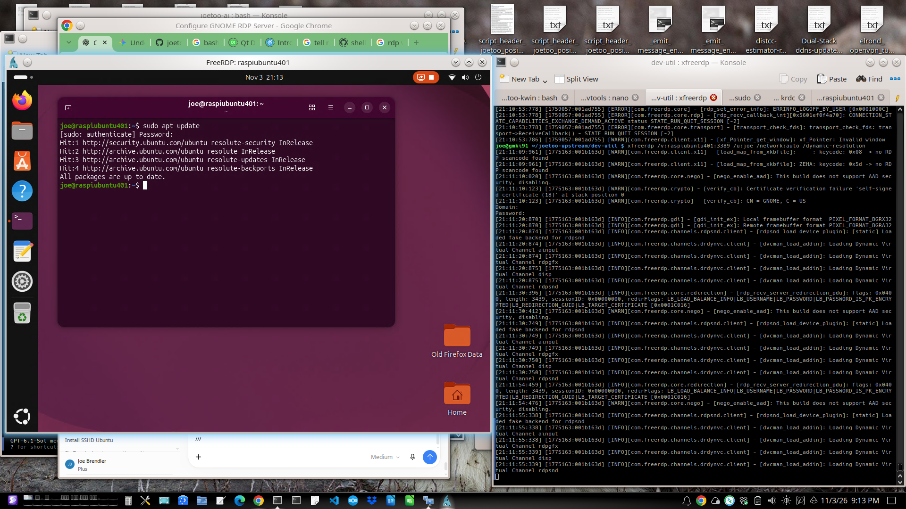

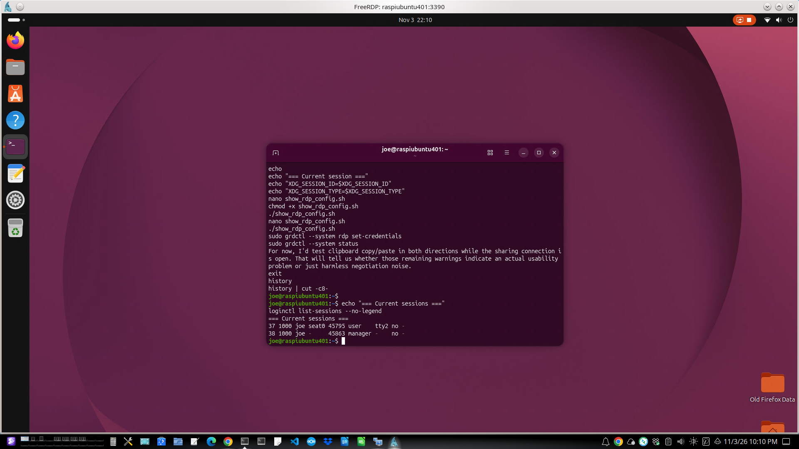

**New `q552u01` Wayland evidence** (working remote-session windows, not yet managed by `joetoo-kwin`):

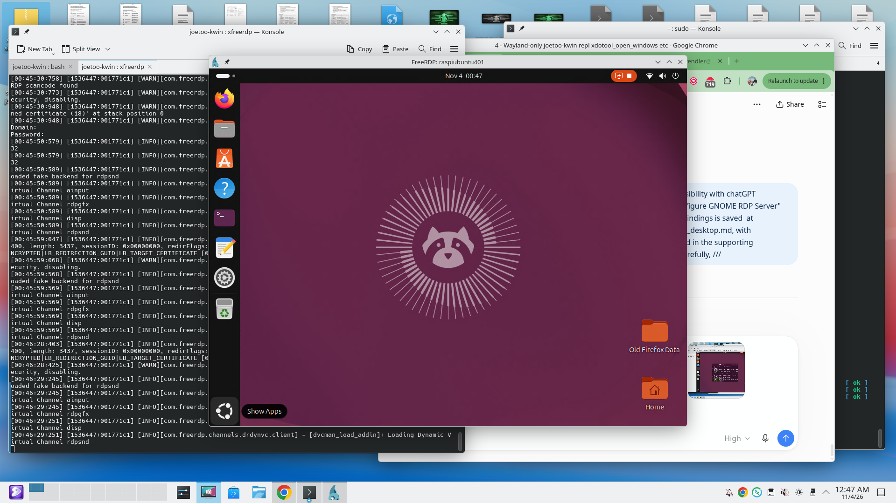

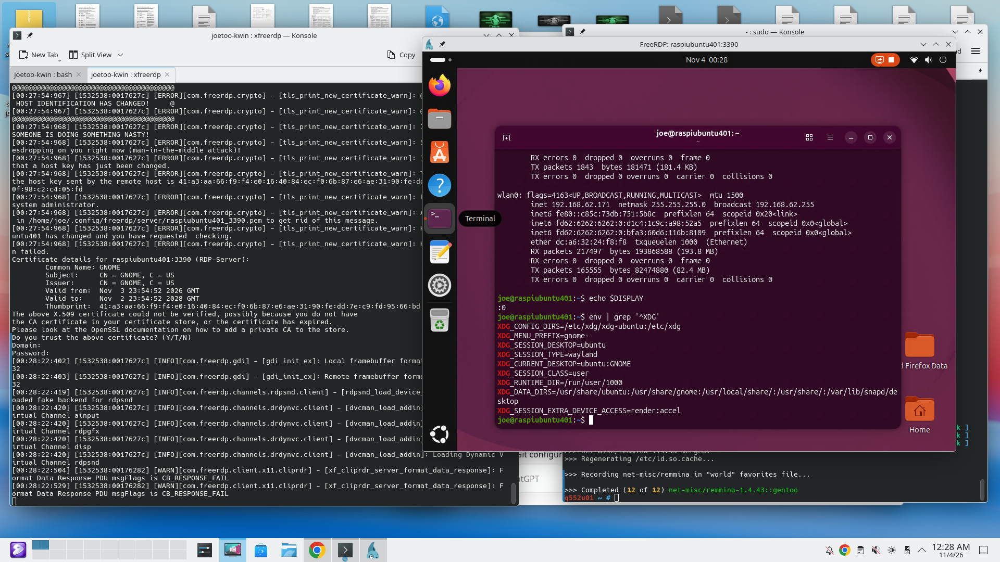

The sharing screenshot includes a FreeRDP warning that the host/certificate identity changed and a trust prompt for the current self-signed certificate. The visible desktop shows connection success, **not** that future connections will pass strict PKI validation.

---

#### 3. KRDC — KDE graphical client

**Installed on original host:** `kde-apps/krdc-26.04.3` with `rdp`, `ssh`, `vnc`, `wayland`; `krdc_rdpplugin.so` was present and loaded. This **KRDC client** is unrelated to the `kde-plasma/krdp` server component installed elsewhere in the feasibility investigation.

Known-good launch forms:

```bash
krdc 'rdp://joe@raspiubuntu401:3389'  # Remote Login
krdc 'rdp://joe@raspiubuntu401:3390'  # Desktop Sharing

# End of commands
```

An earlier attempt in KRDC's GUI produced **Malformed URL** and a `rdp%3A%2F%2F...` double-encoded URL; the explicit, quoted URI above avoided that ambiguity.

##### 3.1 Working local Host Configuration

| KRDC configuration | Original working evidence |
| --- | --- |
| **General** | Resolution **Current Window Size**, acceleration **Use Best Available**, device scale **Auto**, keyboard **US English**, audio **On This Computer**; a default `Share Media` path `file:///media` was not proven valid |
| **Security** | **NLA on, TLS on, RDP on, Ext off**, **TLS security level 192 bit**, Authentication Package List blank; NLA-only with 192 bit also worked in the original trial |
| **Proxy** | HTTP dropdown at default; no server/credentials entered |
| **Gateway** | Transport Auto; server/domain/credentials blank |
| **SSH tunnel** | Disabled |

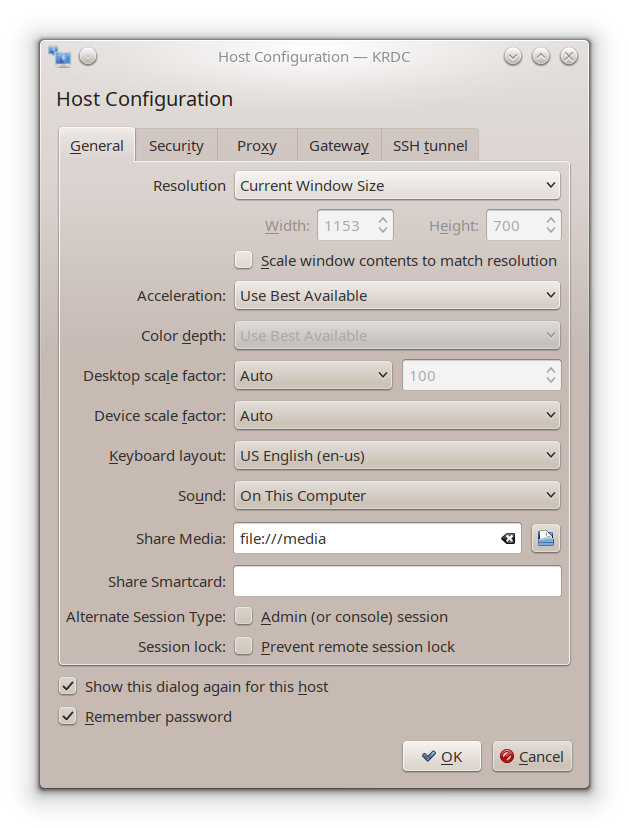

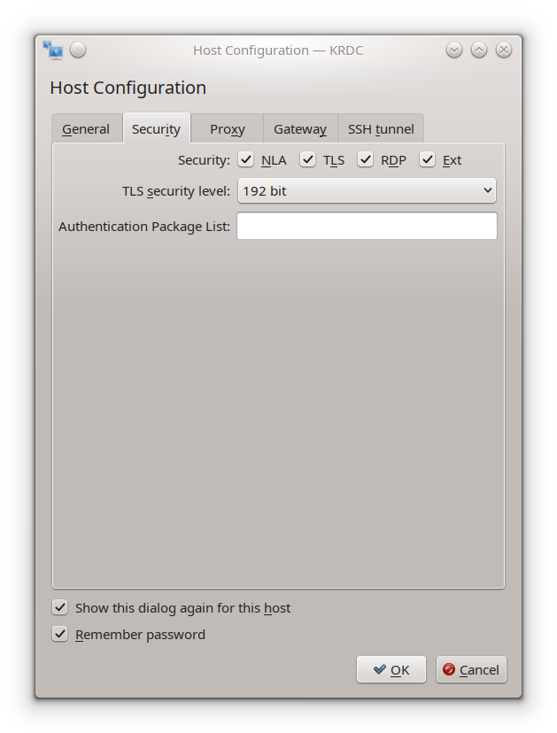

**Historical screenshot caveat:** `06-krdc-security-settings.png` showed all **four** security boxes selected, though the final working choice was NLA + TLS + RDP, **Ext off**. The image supports the **192-bit setting**, not the final exact checkbox set.

##### 3.2 Negotiation observations and limits

- **TLS-only with NLA unchecked** failed with `ERRCONNECT_HYBRID_REQUIRED_BY_SERVER`; GNOME required NLA for this setup.
- **NLA-only at the KRDC 192-bit setting** worked, but NLA/CredSSP is itself TLS-based. “192 bit” is a KRDC security-level setting, **not** the measured TLS cipher's key length.
- **NLA + TLS + RDP at 192 bit** also worked. Earlier 256-bit attempts failed; the underlying cryptographic or configuration cause was **not established**.
- A KRDC GUI checkbox permitting classic RDP is **not evidence that classic RDP security was negotiated**. A production `joetoo-kwin` recipe should establish a verified, no-unsafe-downgrade negotiation policy before unattended use.
- `QtKeychain`/KWallet error and `file:///media` redirection warnings were observed, but not proven causal.

Original evidence:

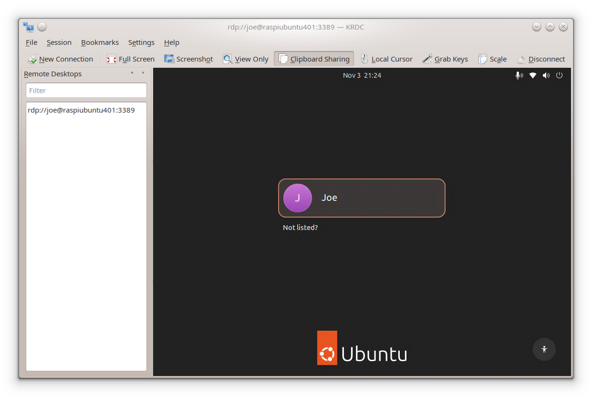

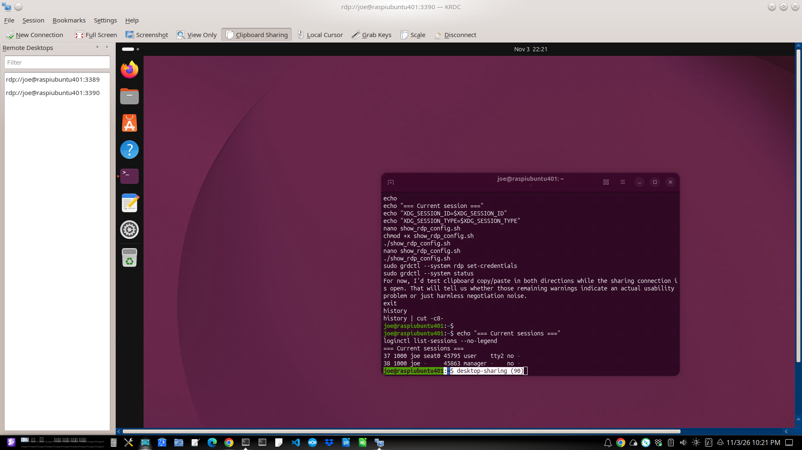

**New `q552u01` Wayland evidence:**

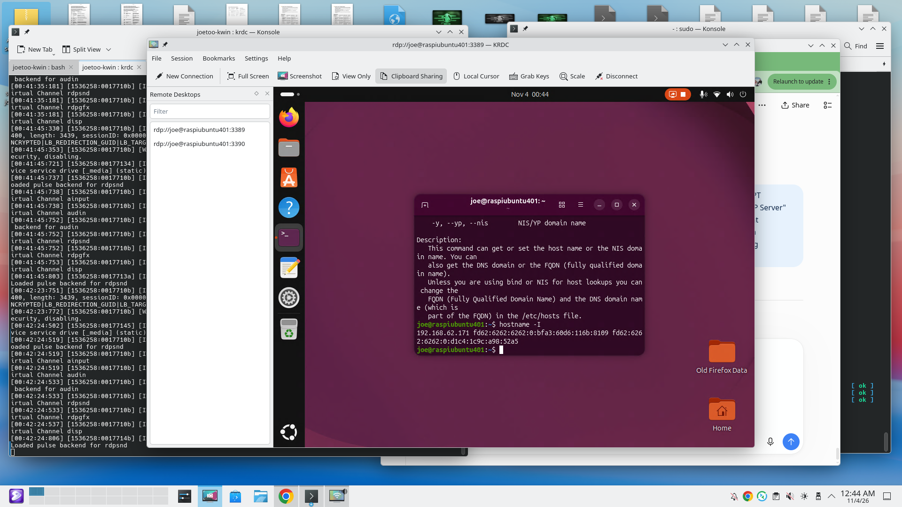

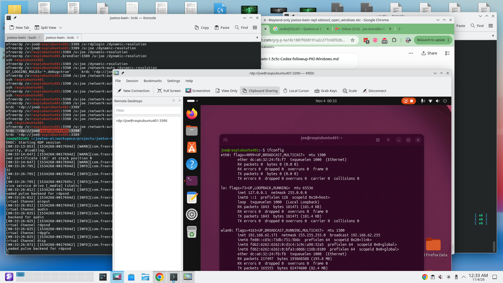

The existing physical desktop was about 1920×1080; inside KRDC's toolbar/sidebar view, use **Full Screen** or client scaling rather than assuming a cropped display is a connection failure.

---

#### 4. Remmina — profile-based graphical client

**Installed:** `net-misc/remmina-1.4.43` with RDP support. The working flow was to create/edit a saved profile with `+`, **Save and Connect**, and subsequently open its row (including right-click **Connect**). Remmina is a **client**; the saved profile is not itself a separate remote server.

##### 4.1 Original working profiles

| Field | Remote Login | Desktop Sharing |
| --- | --- | --- |
| Name | `Quick Connect - raspiubuntu401 remote login` (later renamed) | `Quick Connect - raspiubuntu401 shared desktop` (later renamed) |
| Protocol | RDP | RDP |
| Server | `raspiubuntu401:3389` | `raspiubuntu401:3390` |
| Username | `joe` | `joe` |
| Password | System-level GRD credential | User-level GRD credential |
| Domain / share folder | **blank** | **blank** |
| Security protocol negotiation | Automatic negotiation | Automatic negotiation |
| TLS Security Level | Default | Default |
| Quality | Initially Poor/Fastest, later Best tried | Later Good |
| Audio output | Off | Off |
| SSH tunnel | Off | Off |

The Advanced page showed an **HTTP gateway-transport dropdown** with *no gateway server configured*. This does **not** establish use of an HTTP proxy or Remote Desktop Gateway. **Do not copy KRDC's 192-bit setting into Remmina**: Remmina passed at its own default setting.

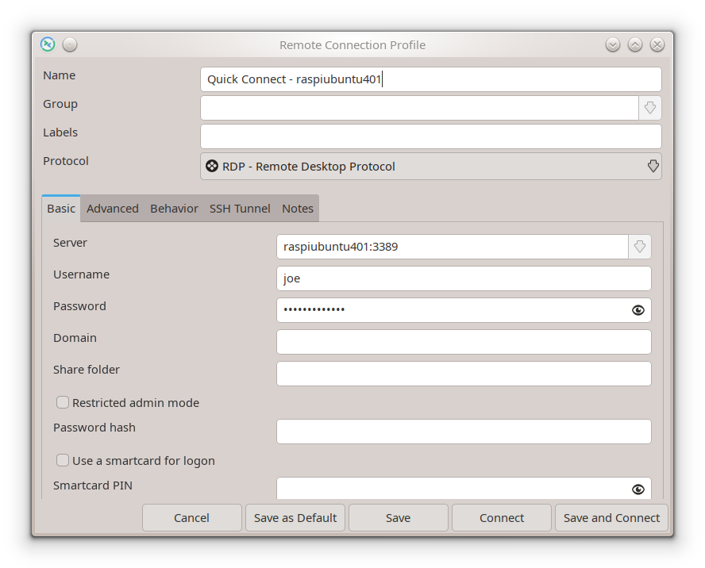

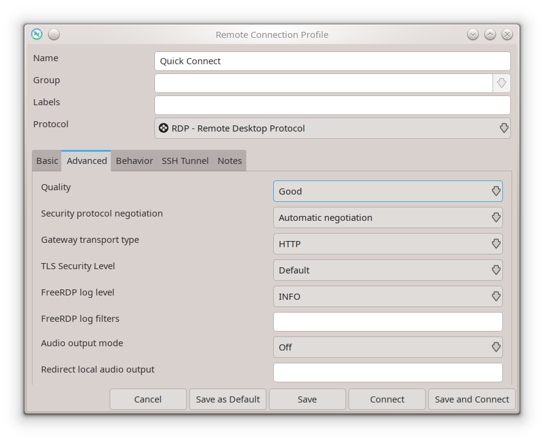

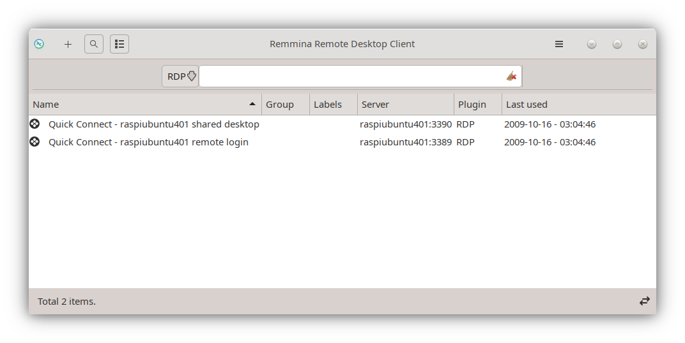

##### 4.2 Connection and session evidence

Remmina Remote Login initially displayed a transient white/blank view for about ten seconds before reaching GDM and a usable remote GNOME desktop. After deliberately disconnecting **without logging out**, a later Remote Login reconnection resumed the same graphical session. **Session persistence through client disconnect** was therefore verified in the original trials; this does not mean a remote session survives a **server reboot**.

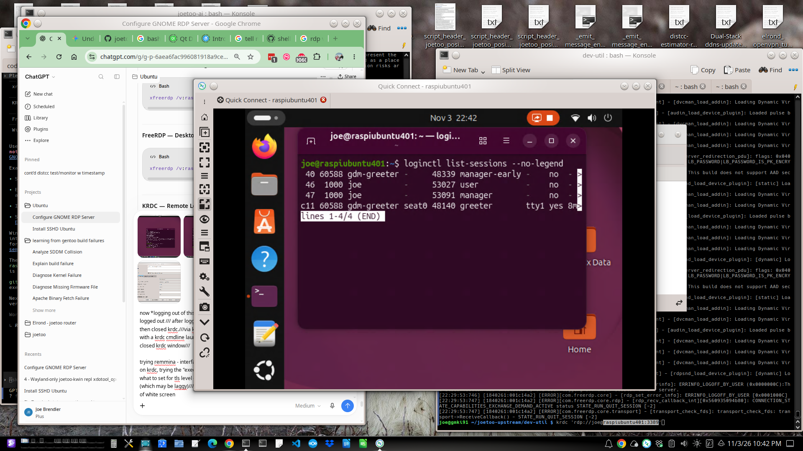

On 3390, Remmina prompted for a **different sharing certificate**, whose fingerprint matched the user GRD certificate in §1.4.

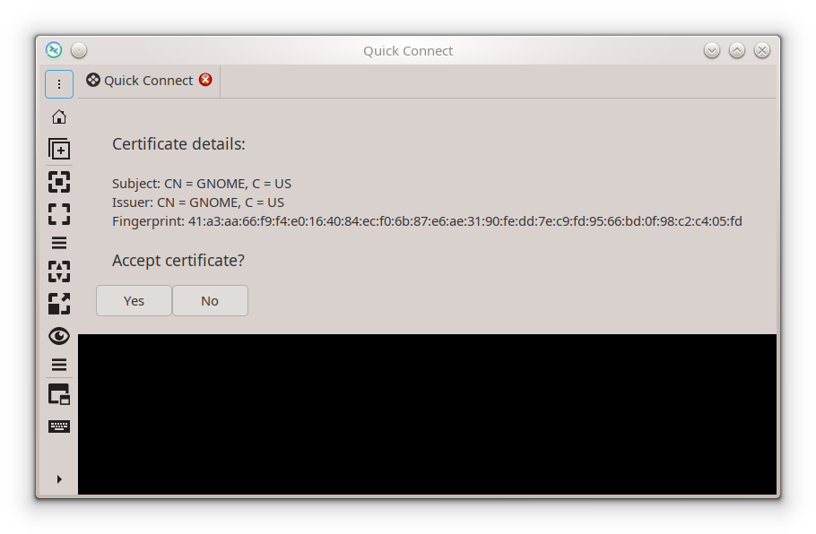

An attempted sharing connection while an active, disconnected Remote Login session still existed could not establish the physical sharing target:

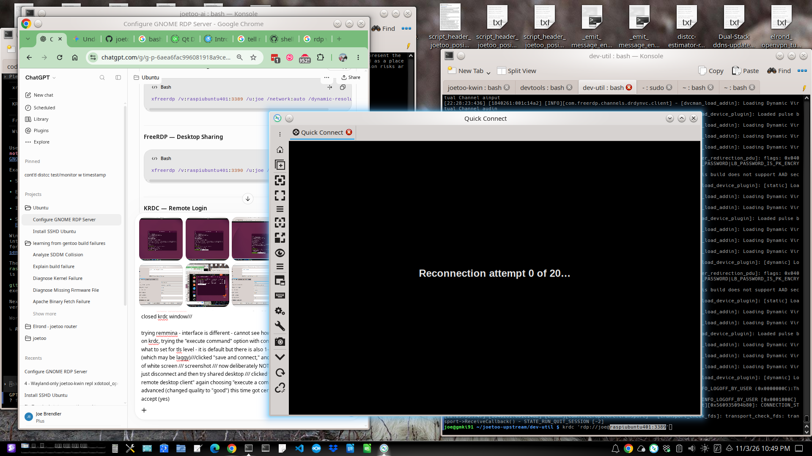

After explicitly logging out of remote GNOME, logging into `joe` locally and leaving GNOME unlocked, sharing worked:

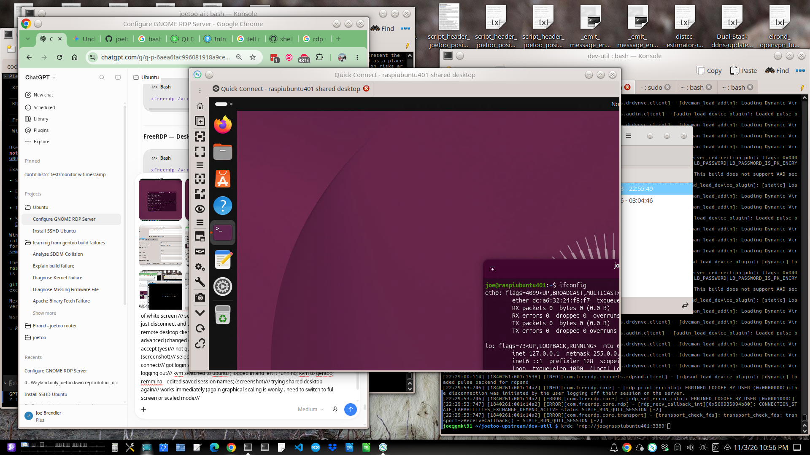

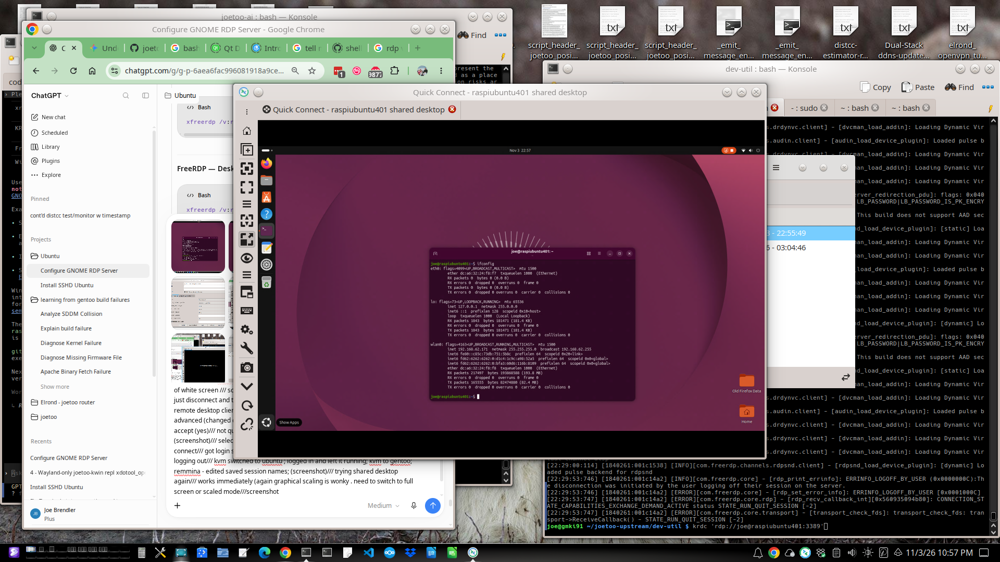

The full-size physical desktop can be cropped inside a smaller viewer. Remmina's **scale-to-window** and full-screen settings are viewing conveniences, not server-side GNOME authentication changes. Quality presets were tried but no controlled bandwidth, latency or CPU comparison was performed.

**New `q552u01` Wayland evidence:**

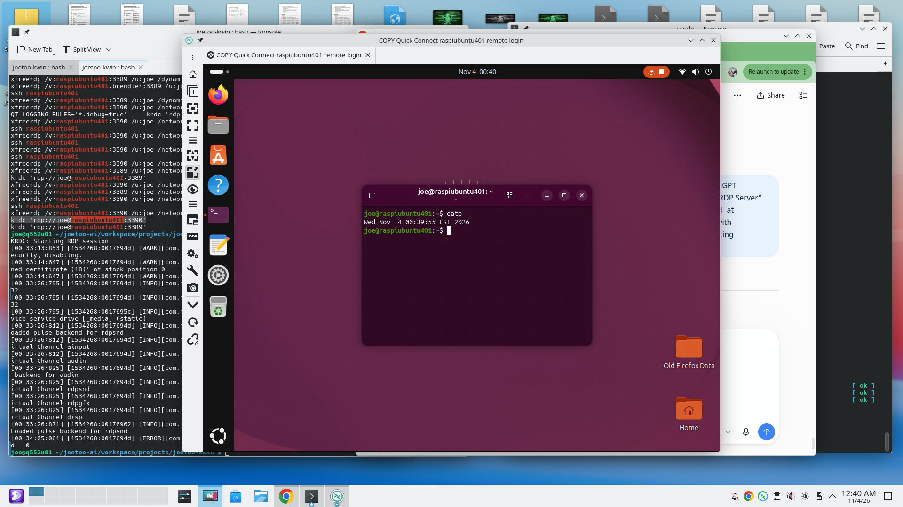

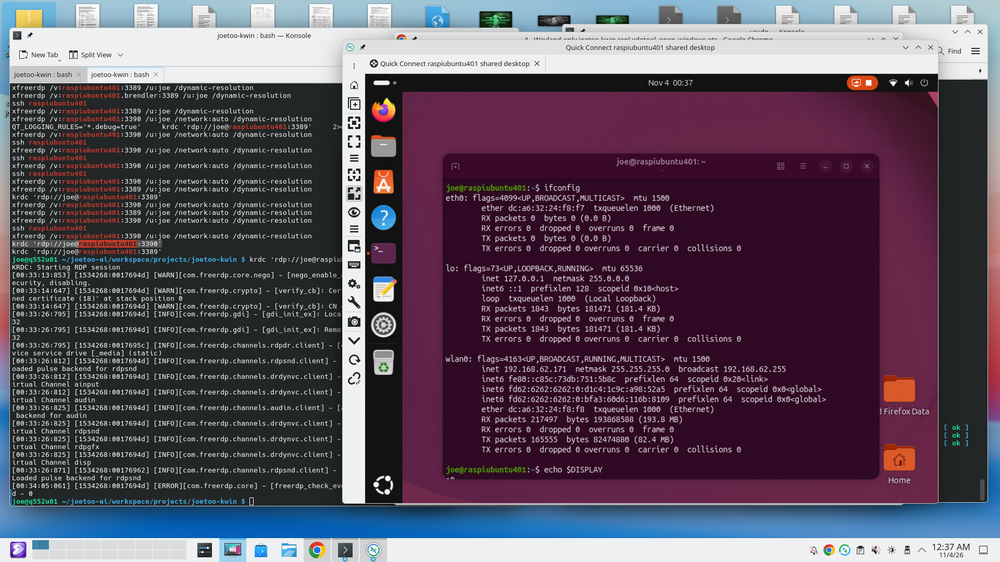

---

#### 5. SDL FreeRDP — additional cross-backend Remote Login result

FreeRDP 3.32.1 with SDL support provides the installed `sdl-freerdp` frontend. The maintainer tested the following **same command** on **both** `gmki91` X11 and `q552u01` Wayland:

```bash
sdl-freerdp /v:raspiubuntu401:3389 /u:joe /network:auto /dynamic-resolution

# End of commands
```

Both tests produced a visible, usable GNOME Remote Login desktop:

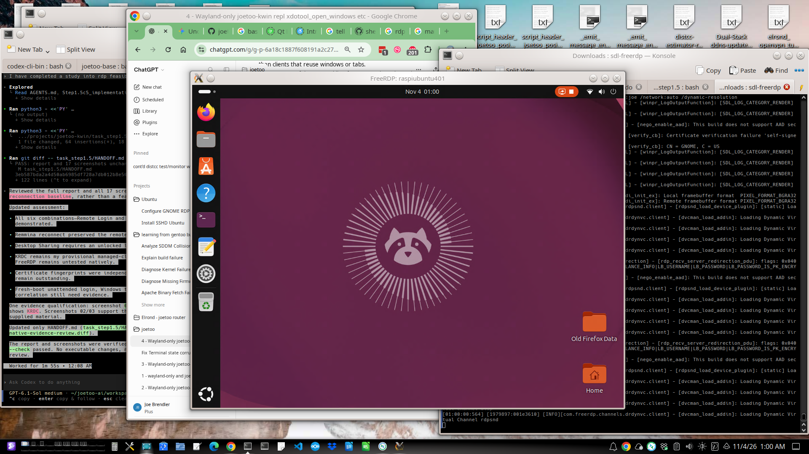

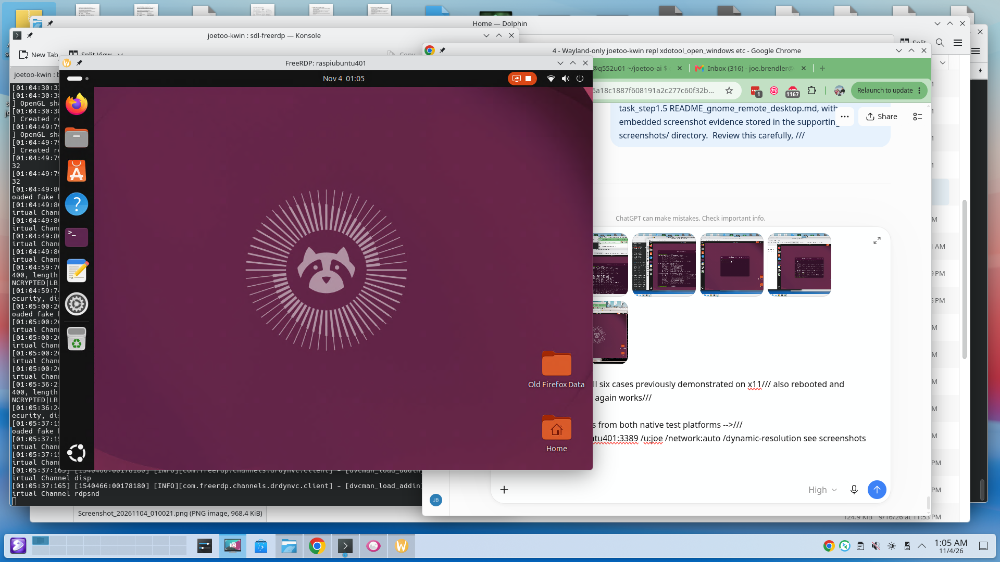

**What this establishes:** SDL FreeRDP can serve as a working graphical RDP *client* when invoked from either of the joetoo native test desktop environments. This is important because Gentoo explicitly masks `>=net-misc/freerdp-3 wayland` in `profiles/base/package.use.mask` due to the older upstream Wayland frontend. That mask does **not** disable the independently built SDL frontend or prevent an X11 client from running under XWayland.

**What remains open:** The screenshots do **not** identify the actual SDL video driver or prove the SDL window was native Wayland rather than XWayland. They also do **not** establish a working `sdl-freerdp` **Desktop Sharing 3390** case, exact PID→KWin UUID registration, managed placement, credential-prompt ownership, or the security of automatic certificate acceptance. The SDL command line shown includes no password; the visible terminal logs still include certificate verification warnings for a self-signed GNOME certificate. PKI trust and frontend dialog behavior require explicit review before automated integration.

---

#### 6. GNOME session lifecycle and operational limitations

##### 6.1 Do not conflate remote viewer and GNOME session state

- **Disconnect or close RDP viewer:** ends that connection. A GNOME **Remote Login** user session may remain alive and be reconnected to; Remmina reconnection verified this on the tested server.
- **Log Out inside GNOME:** terminates the graphical login session. A viewer attached to it disconnects because the remote desktop has ended.
- **Lock existing local GNOME desktop:** in the observed setup, **Desktop Sharing** connections were inhibited or disconnected until the physical session was unlocked locally.
- **Attempt Remote Login as `joe` when `joe` is already graphically logged in:** GNOME/GDM may report **Session Already Running** and offer **Cancel** or **Force Stop**. Force Stop risks terminating an existing user session and unsaved work. It must not be automated casually.

**Switching Remote Login → Desktop Sharing:** save work, log out of the remote GNOME session (do **not** just close the client), log in locally as `joe`, leave the desktop unlocked, then connect to `3390` using user-scoped GRD credentials.

**Switching Desktop Sharing → Remote Login:** save work and log out of the local GNOME session when appropriate, then connect to `3389` using system-scoped GRD credentials and complete GDM login. During initialization a gray/charcoal or blank screen may appear transiently; one attempt stayed dark and was closed, another reached the GNOME desktop after ~10 seconds. A persistent blank screen is not a successful session.

**Preserve a Remote Login session temporarily:** close only the viewer; reconnect later to `3389`. The disconnected graphical `joe` session may continue to prevent a competing local `joe` login.

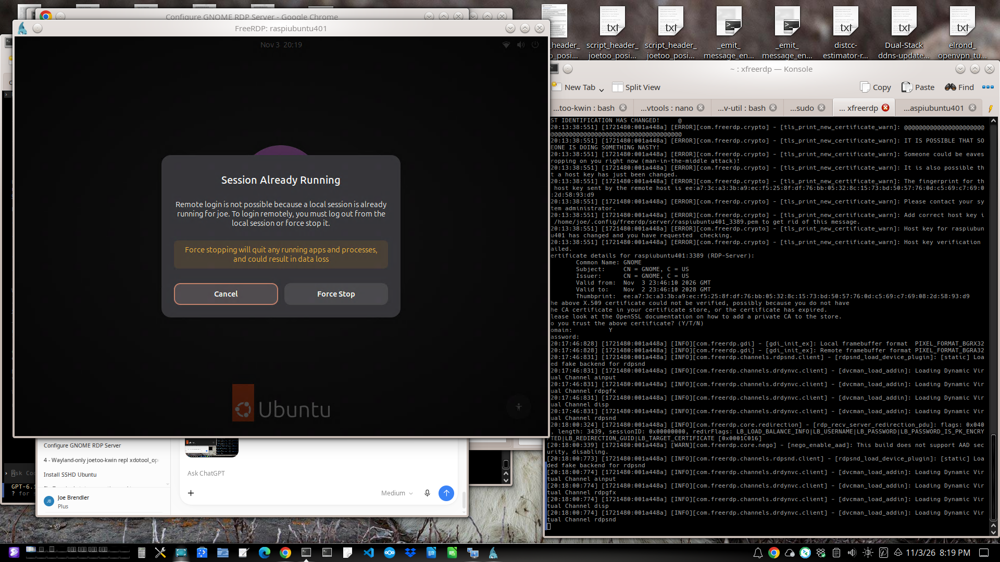

##### 6.2 Screen-lock inhibition and later viewer disappearance

One early 3390 attempt authenticated far enough to establish graphics channels, then terminated with `ERRINFO_LOGOFF_BY_USER (0x0000000C)`. The contemporaneous **server** journal was more diagnostic:

```text
Failed to start remote desktop session:
GDBus.Error:org.freedesktop.DBus.Error.Failed: Session creation inhibited
... ERRINFO_RPC_INITIATED_DISCONNECT [0x00010001]
```

After using the local KVM to **unlock** GNOME, Desktop Sharing worked. That supports the lock explanation strongly, though the specific lock event timestamp was not independently captured.

A later Remmina shared-desktop viewer closed with Plasma's configured “explode” animation. This was **likely** another inactivity-lock event, but no matching server journal for that specific disappearance was saved. The animation itself is not evidence of a Remmina graphics crash.

##### 6.3 `loginctl` session accounting

A captured `loginctl list-sessions` output contained an SSH session, a `joe` systemd user manager, GDM greeter entries, and a single remote Wayland graphical session for `joe`. An inspected remote graphical session showed `Service=gdm-password`, `Type=wayland`, `Remote=yes`, a nonblank `RemoteHost`, and `State=active`.

**Do not infer two graphical logins merely from multiple `loginctl` rows.** Session IDs are ephemeral; do not hardcode values into scripts. Useful diagnostics:

```bash
loginctl list-sessions
loginctl show-session SESSION_ID \
  -p Name -p Type -p Class -p Service -p Remote -p RemoteHost \
  -p State -p Active -p TTY -p Leader
who -a
systemd-inhibit --list
ps -eo pid,ppid,user,tty,stat,etime,args --forest | \
  grep -E 'gnome-shell|gnome-session|gdm|gnome-remote-desktop|Xwayland|sshd|systemd --user'

# End of commands
```

A previously refused reboot was associated with other-session warnings, but the exact blocker was **not established**. Avoid indiscriminate `loginctl terminate-user joe`, Force Stop, or forced reboot while work may be unsaved.

##### 6.4 New post-reboot observation (2026-11-04)

The maintainer **rebooted `raspiubuntu401` and successfully connected by Remote Login again**. This supersedes the original report's suggestion that Remote Login *had not been tried at all* after a reboot. It demonstrates post-reboot service usability, **not** survival of an existing GNOME user session through reboot. The supplied statement does not independently establish whether that Remote Login occurred before any local user login, nor whether both sockets and Desktop Sharing were rechecked after boot. Those remain narrower follow-up questions, not grounds to repeat the six already completed client/mode tests.

---

#### 7. Troubleshooting reference and corrected interpretations

| Observation | Established cause or qualified interpretation |
| --- | --- |
| `xfreerdp3: command not found` | FreeRDP 3.32.1 on this Gentoo host installs `xfreerdp`. |
| TCP reset on 3389 while system GRD said enabled | System journal: `[RDP] Credentials are not set, denying client`; set **system** RDP credentials. |
| Trying `/u:rdplogin` | That was not the configured name; the configured RDP username was `joe`. |
| `/v:joe@raspiubuntu401:3389` | Invalid FreeRDP host argument for these tests; pass `/v:raspiubuntu401:3389 /u:joe`. |
| Self-signed or changed host certificate warning | GRD uses separate original self-signed certificates; compare the actual server fingerprint before any trust decision. PKI validation not established. |
| Desktop Sharing `ERRCONNECT_LOGON_FAILURE`, NTLM `MIC verification failed` | User GRD credentials incorrectly set in the system scope; corrected with user-scoped `grdctl`. |
| Sharing viewer appears then closes | Server `Session creation inhibited` and unlock-then-success support local screen lock as cause. |
| Entering `.brendler` as RDP Domain | DNS suffix is not the RDP auth domain; leave blank here. |
| KRDC malformed URL | GUI encoded URI scheme into address; use `krdc 'rdp://joe@host:port'`. |
| KRDC TLS-only, NLA off | Server rejected negotiation with `ERRCONNECT_HYBRID_REQUIRED_BY_SERVER`. |
| KRDC 256-bit level failure then 192-bit success | Verified configuration difference; exact negotiated cipher/cause undetermined. |
| KRDC KWallet/QtKeychain or `file:///media` warning | Observed but not proven to cause auth failures. |
| Remmina shared-desktop retry while remote `joe` session persisted | Remote session and local shareable user session conflicted; logging out remote GNOME cleared the workflow. |
| Initial blank Remmina window | Approximately ten-second startup delay before usable GNOME; not necessarily failure. |
| 1920×1080 desktop cropped by viewer | Client scaling/full-screen presentation issue, not GRD auth failure. |
| FreeRDP `-aad` or XKB warnings, clipboard `CB_RESPONSE_FAIL` | Nonfatal in the original tests; ordinary text clipboard was bidirectional. |
| `ERRINFO_LOGOFF_BY_USER` | Protocol reason, not proof a human chose Log Out; cross-check server journal. |
| FreeRDP 3 `(-wayland)` | Confirmed Gentoo base-profile package USE mask of deprecated old client frontend; **not** proof that `xfreerdp` or `sdl-freerdp` fails in a Wayland Plasma session. |
| SDL FreeRDP TLS verification warning despite visible desktop | Working graphics is not authenticated certificate-chain verification; evaluate the actual trust decision and negotiated policy separately. |

##### Read-only server diagnostics

```bash
# Listeners and two independent configuration scopes
sudo ss -ltnp | grep -E ':(3389|3390)\b'
sudo grdctl --system status
grdctl status

# System-level Remote Login
systemctl status gnome-remote-desktop.service --no-pager -l
sudo journalctl -b -u gnome-remote-desktop.service -n 60 --no-pager -l

# User-level Desktop Sharing
systemctl --user status gnome-remote-desktop.service --no-pager -l
journalctl --user -b -u gnome-remote-desktop.service -n 60 --no-pager -l

# GDM and graphical session state
systemctl status gdm.service --no-pager -l
loginctl list-sessions

# End of commands
```

For a specific failure, use corresponding timestamps in both client and server logs, changing one variable at a time:

```bash
journalctl --user -b -u gnome-remote-desktop.service \
  --since '2026-11-03 20:50:00' --until '2026-11-03 20:51:00' \
  --no-pager -l

# End of commands
```

---

#### 8. Implications for `joetoo-kwin` Step 1.5c.5c

**Subsequent milestone decision (2026-11-05):** the maintainer closed 1.5c.5c
with affirmative feasibility after the SDL identity investigations recorded in
[HANDOFF.md](HANDOFF.md), including native-Wayland negative/coexistence tests.
The study below retains its original evidence boundaries. Step 1.5c.5d is the
next managed RDP milestone, with SDL first by implementation sequence; accepted
TigerVNC and future separately approved RDP clients are user-selectable peers.
No executable increment is authorized by this documentation update.

This study establishes a **working RDP server/client interoperability baseline on both joetoo native test platforms**, but it does **not** itself implement a managed RDP launch recipe in `joetoo-kwin`.

1. **Viewer lifecycle ≠ GNOME login-session lifecycle.** Closing the local viewer might preserve a Remote Login GNOME session; never equate closing a window, disconnecting TCP and logging out remotely.
2. **Server responsibilities remain external.** GRD configuration, GDM login policy, local console locks, credential stores, TLS certificates and host firewall are prerequisites managed independently. `joetoo-kwin` should initially manage only local client launch, positive KWin window identity, desktop/slot/geometry/layer placement, and truthful launch/transport reporting.
3. **Credentials and server identity are independent of window placement.** System Remote Login and user Desktop Sharing require separate RDP credentials and certificates. Never commit passwords or automatically waive certificate warnings in an unattended invocation.
4. **Native backend support is now demonstrated at the GUI interoperability level.** `xfreerdp`, KRDC and Remmina were all manually observed in both server modes under KDE X11 and KDE Wayland; SDL FreeRDP remotely logged in from both. This is sufficient to consider them *pilot candidates*, not to assert exact KWin UUID enrollment or whether SDL used native Wayland versus XWayland.
5. **Protocol/client security remains a gate.** Determine the actual negotiated NLA/TLS behavior, certificate chain/name validation, downgrade handling and credential UI. A checked GUI option or successful remote desktop alone does not establish a verified cryptographic policy.
6. **Positive desktop-window identity must be proved before integration.** Authentication dialogs, saved-profile delegation and potential reuse of a single client process require targeted PID/UUID testing. We cannot automatically repurpose the TigerVNC enrollment assumptions.
7. **Display policy is client- and server-mode-dependent.** Remote Login can use virtual dimensions/dynamic resolution; physical Desktop Sharing mirrors an already running display. Neither should silently override the joetoo shared geometry or initial placement contract.
8. **Failure classification should remain specific.** GNOME lock, expired/changed TLS cert, missing credentials, ongoing remote session, transient black screen and graphical client exit are distinct conditions. Keep logs visible rather than converting every failure into “window launch failed.”
9. **Preserve the accepted VNC-over-SSH path.** It remains a separate working baseline; this study establishes RDP feasibility rather than acceptance of a replacement implementation.

These GNOME/GDM observations should **not** be assumed to describe a Gentoo `krdpserver`, `xrdp`, SDDM, or Windows RDP server without separate evidence. Windows remote login/attended-sharing remains an explicit future evaluation target, not a result of the Ubuntu tests.

#### 9. Remaining work and evidence limitations

- **Server reboot:** Remote Login was successfully re-established after reboot (**now verified**). The exact first-login sequence before any local console login, post-boot listener inventory, and Desktop Sharing after that same reboot were **not separately documented**.
- **Certificate policy:** Replace the two self-signed certificates with SAN-correct certificates from the maintainer's existing PKI, then verify trust chains, hostname matching and any pinning behavior in KRDC, Remmina and FreeRDP (system and user listeners separately). **Not yet done**.
- **Negotiated RDP security:** Determine actual TLS cipher/protocol and NLA or downgrade behavior, particularly KRDC's 192-bit setting. Do not infer cryptographic strength from a UI label.
- **SDL frontend:** Subsequent native evidence confirmed SDL's `wayland` backend on `q552u01` and the marker/PID/UUID viewer distinction, including cancellation, failed NLA, connection failure and unrelated-viewer coexistence; see HANDOFF iterations 40–44. Production certificate behavior remains unverified; optional SDL Desktop Sharing (3390) remains a separate, untested capability.
- **Managed client pilot:** Verify exact KWin PID/UUID identity, authentication pre-window, desktop/slot/geometry/stack, window reuse, cancellation and exit for selected RDP clients. **No such `joetoo-kwin` RDP integration tests were performed.**
- **Lock behavior:** Correlate an actual GNOME inactivity lock with journal timestamps. Earlier `Session creation inhibited` evidence is strong; a later spontaneous Remmina close remained inferred.
- **Performance and peripheral features:** No controlled latency, CPU/network, codec or audio redirection benchmarks. Plain-text clipboard was originally tested in both directions; file transfers and arbitrary MIME types were not established.
- **Windows server:** Windows RDP host capability, local console semantics, certificates and remote login/attended sharing have **not** been tested in this Ubuntu study.
- **Access policy:** No firewall-rule modification was documented. Keep RDP limited to approved LAN/VPN exposure; no unreviewed public Internet forwarding.
- **Client versions:** The documented investigation used FreeRDP 3.32.1, KRDC 26.04.3 and Remmina 1.4.43. Recheck versions and settings if updating the packages.

#### 10. Screenshot evidence index

Original collection files `01`–`17` are retained as-is. The new `18`–`25` files are supplied in the accompanying evidence bundle and should be placed in the same `task_step1.5/screenshots/` directory. Screenshots may depict intermediate settings or nonfatal diagnostics; source-specific written working configurations take precedence.

| Relative screenshot path | What it establishes |
| --- | --- |
| `screenshots/01-freerdp-remote-login-gdm.png` | Initial X11 FreeRDP/GDM login |
| `screenshots/02-freerdp-remote-login-session.png` | Original X11 FreeRDP Remote Login GNOME desktop |
| `screenshots/03-freerdp-desktop-sharing.png` | Original X11 FreeRDP Desktop Sharing |
| `screenshots/04-krdc-remote-login.png` | Original X11 KRDC GDM login |
| `screenshots/05-krdc-general-settings.png` | Original KRDC General settings |
| `screenshots/06-krdc-security-settings.png` | KRDC 192-bit security setting; interim all-four-boxes screenshot |
| `screenshots/07-krdc-desktop-sharing.png` | Original X11 KRDC Desktop Sharing |
| `screenshots/08-remmina-profile-basic.png` | Remmina Basic settings |
| `screenshots/09-remmina-profile-advanced.png` | Remmina Advanced settings |
| `screenshots/10-remmina-remote-login.png` | Original X11 Remmina Remote Login |
| `screenshots/11-remmina-cert-3390.png` | Remmina user GRD certificate prompt |
| `screenshots/12-remmina-connection-retry.png` | Remmina sharing connection retry/failure |
| `screenshots/13-remmina-saved-profiles.png` | Two separate Remmina RDP profiles |
| `screenshots/14-remmina-desktop-sharing-window.png` | Original X11 Remmina sharing at physical resolution |
| `screenshots/15-remmina-desktop-sharing-scaled.png` | Original X11 Remmina scaled sharing view |
| `screenshots/16-freerdp-session-already-running.png` | GDM session conflict/Force Stop warning |
| `screenshots/17-krdc-initial-malformed-url.png` | Earlier KRDC URI parsing failure |
| `screenshots/18-wayland-xfreerdp-desktop-sharing.png` | **NEW:** `q552u01` Wayland, `xfreerdp`, Desktop Sharing port 3390; visible cert warning |
| `screenshots/19-wayland-krdc-desktop-sharing.png` | **NEW:** `q552u01` Wayland, KRDC, Desktop Sharing 3390 |
| `screenshots/20-wayland-remmina-desktop-sharing.png` | **NEW:** `q552u01` Wayland, Remmina, Desktop Sharing 3390 |
| `screenshots/21-wayland-remmina-remote-login.png` | **NEW:** `q552u01` Wayland, Remmina, Remote Login 3389 |
| `screenshots/22-wayland-krdc-remote-login.png` | **NEW:** `q552u01` Wayland, KRDC, Remote Login 3389 |
| `screenshots/23-wayland-xfreerdp-remote-login.png` | **NEW:** `q552u01` Wayland, `xfreerdp`, Remote Login 3389 |
| `screenshots/24-x11-sdl-freerdp-remote-login.png` | **NEW:** `gmki91` X11, `sdl-freerdp`, Remote Login 3389 |
| `screenshots/25-wayland-sdl-freerdp-remote-login.png` | **NEW:** `q552u01` Wayland, `sdl-freerdp`, Remote Login 3389 |

---

**Updated conclusion (2026-11-04):** The GRD server's two independent service modes, credentials and certificates were established; three GUI clients worked in both modes on **each** joetoo KWin test backend; SDL FreeRDP additionally worked for Remote Login on **both** backends; and Remote Login was reconfirmed after reboot. GNOME-session state, authenticated server identity, client GUI window identity and managed `joetoo-kwin` placement remain conceptually separate. The study now establishes a **cross-backend RDP feasibility baseline**, not production RDP security acceptance or an implemented joetoo-kwin RDP recipe.

---

## Appendix B — Detailed RDP feasibility and SDL identity investigations

The following substantive research sections were moved from the
[pre-dispatcher historical HANDOFF](
https://github.com/JosephBrendler/joetoo-ai/blob/8f01b6859b3242333ffaa46c931629813921539b/workspace/projects/joetoo-kwin/task_step1.5/HANDOFF.md),
blob `e49e00c724f153f4b548fdd582bf2ed407c5c604`. They cover the researched server/client
choices, certificate/security limitations, diagnostic tooling, X11 viewer
lifecycles and native-Wayland UUID evidence. Historical next-action and
approval language embedded in these findings **does not authorize work**;
the active HANDOFF and explicit maintainer directions alone control that.

### 1.5c.5c findings — research 2026-11-03; native evidence reviewed 2026-11-04

**Server/session decision first.** Sharing exposes an existing graphical session;
remote login starts one without a physical user login; headless means no physical
display, not necessarily no session; persistence means reconnecting after network
loss, not recovering a session after logout/reboot. Client X11/Wayland and server
Xorg/Wayland are independent choices across RDP.

| Server | Session model and prerequisites | Assessment |
| --- | --- | --- |
| GNOME Desktop Sharing | Existing logged-in GNOME session; user service/Mutter/PipeWire; sharing credentials | Does not meet logged-out login goal. |
| GNOME Remote Login | GNOME 46+/GDM; system GRD service; entry credentials then OS-user login. Upstream 47 adds persistent remote-login sessions | Now demonstrated on Ubuntu 26.04.1 Raspberry Pi 4, including reconnect persistence; fresh-boot login remains untested. Ubuntu 24.04 persistence/backports remain separate. Documented service setup uses systemd; Gentoo/OpenRC server portability is unestablished. |
| xrdp + xorgxrdp | xrdp/sesman/PAM creates separate virtual Xorg desktop; no physical login or GDM required; reconnect policy configurable | Alternative for persistent independent sessions. Needs an Xorg-capable desktop (e.g. Xfce), not a Wayland-only GNOME session. Upstream permits non-systemd builds; local Gentoo/OpenRC packaging/PAM integration not established. |
| KRDP 6.7.5-r1 | Shares current Plasma Wayland session; screencast/portal, user authentication; virtual monitor does not create a new login | Defer as solution to logged-out remote login. Installed without systemd USE; upstream KCM service-control instructions cannot be assumed to work on OpenRC. |

Sources: [Ubuntu sharing/login](https://documentation.ubuntu.com/desktop/en/24.04/how-to/share-your-desktop-remotely/),
[GNOME configuration](https://github.com/GNOME/gnome-remote-desktop/blob/main/docs/configuration.md),
[46 login](https://release.gnome.org/46/), [47 persistence](https://release.gnome.org/47/),
[Ubuntu 26.04 GNOME 50](https://documentation.ubuntu.com/release-notes/26.04/changes-since-previous-interim/),
[xrdp 0.10.5](https://github.com/neutrinolabs/xrdp/tree/v0.10.5),
[session policy](https://github.com/neutrinolabs/xrdp/blob/v0.10.5/sesman/sesman.ini.in).
KRDP assertions checked against cached `krdp-6.7.5.tar.xz` server/main.cpp,
SessionController.cpp, RdpConnection.cpp and Gentoo patchset (no NLA changes).

**gmki91 installed clients, ranked provisionally.** Exact cached release source
and installed manpages inspected; none has demonstrated native KWin identity yet.
There is no executable RDP recipe in `-o`; subsequent maintainer manual-client evidence is assessed below.

| Candidate | Invocation/security | Identity/backend tradeoff |
| --- | --- | --- |
| 1. KRDC 26.04.3, rdp/ssh/vnc/wayland | `krdc rdp://HOST:PORT`; prompts/KWallet; certificate and changed-certificate dialogs | Fresh QApplication/MainWindow per invocation in main.cpp; Qt X11/Wayland capable. Best first managed-client candidate; separate auth dialogs and pre-login main-window placement need native acceptance. |
| 2. SDL3 FreeRDP 3.32.1 | `sdl-freerdp /v:HOST:PORT`; shared FreeRDP cert/security controls; no password argv | SDL3 has X/Wayland support locally; dialogs/viewport/window lifecycle require observation. Installed SDL3 supports both backends. |
| 3. Remmina 1.4.43, rdp/ssh/vnc/wayland/kwallet | `remmina -c PROFILE.remmina` or password-free RDP URI; cert_ignore defaults off in plugin source | GTK3 X/Wayland capable; GApplication command delegation/tab reuse complicates exact launched-PID ownership. `--new` creates a profile, not an isolated process. |
| Reference: xfreerdp 3.32.1 | `/v:HOST:PORT`, `/u:USER`, `/d:DOMAIN`, `/size:WxH`; stdin/interactive credentials | X11/XWayland, not native Wayland. Simpler per-process reference; native client/dialog identity still untested. |

`wlfreerdp` is absent. The inherited **Gentoo base**
`profiles/base/package.use.mask:334` masks `>=net-misc/freerdp-3 wayland` because
the old frontend is broken/deprecated ([bug 930197](https://bugs.gentoo.org/930197));
profile ancestry was inspected, not attributed to joetoo hardening. Exact 3.32.1
Wayland CMake marks that frontend unmaintained. This does not disable SDL3,
GTK or Qt Wayland support. FreeRDP installed USE includes client/X/sdl/server,
but not kerberos; do not promise Kerberos SSO. q552u01 inventory is deferred
until preparing the native client comparison, not assumed identical.

**Security and integration gates.** Existing VNC supervisor uses strict SSH
host-key checking, BatchMode, dedicated owned master, no agent/X11 forwarding,
and local/remote loopback forwarding; local listener/teardown were natively
accepted. Remote VNC listener exposure remains independently checked, not proven
by the forwarding destination. RDP is not intrinsically safer than this design.
Require verified CA/name or independently confirmed certificate pins, no ignore
or automatic TOFU, no password in URI/argv/logs, and no classic-RDP downgrade.
KRDC's core/krdc.kcfg defaults NLA/TLS/**classic RDP** all on; a pilot needs explicit
policy. Remmina cert_ignore is off by default but is configurable. xrdp's stable
0.10.5 template permits TLS/classic negotiation; use a TLS-only policy if selected.
Do not assume server NLA: [xrdp NLA PR 3868](https://github.com/neutrinolabs/xrdp/pull/3868)
is open; KRDP 6.7.5 RdpConnection.cpp explicitly sets NlaSecurity=false/TlsSecurity=true,
contrary to its stale README NLA-only claim. Record actual Ubuntu negotiation.
Use existing restricted LAN/VPN access; no Internet forwarding or VPN gate.
An SSH-carried RDP alternative would still need certificate-name/redirection tests.

Source anchors: current [VNC supervisor](../libexec/joetoo_kwin_vnc_launch.py)
ssh_argv/control_argv; broker _poll_correlation requires new source-consistent
UUID/exact PID and rejects ambiguity. [KRDC main](https://github.com/KDE/krdc/blob/v26.04.3/main.cpp),
[KRDP security](https://github.com/KDE/krdp/blob/v6.7.5/src/RdpConnection.cpp),
[SDL3 frontend](https://github.com/FreeRDP/FreeRDP/tree/3.32.1/client/SDL/SDL3),
[Remmina source](https://gitlab.com/Remmina/Remmina/-/tree/v1.4.43).
No RDP class/title/window-order adoption or reuse of TigerVNC role signaling is justified.

**Focused follow-up: private PKI and Windows (2026-11-03).** The maintainer
already operates root/intermediate CA and certificate-administration utilities on
three workstations. Reuse that workflow; no CA, key or credential material was
inspected. Recommend server-authentication leaf certificates with matching DNS
SANs (IP SANs for literal-IP connections), suitable key usage and protected,
service-readable matching private keys. Serve leaf plus intermediate certificates;
trust the root through the actual client trust store. Never deploy CA signing keys.
FreeRDP 3.32.1 crypto/x509_utils.c loads OpenSSL default trust paths; KRDC/SDL use
FreeRDP but actual trust-store/name checks still need native verification. A valid
certificate authenticates the server, not the user, and does not replace NLA/PAM.
Do not assume intermediate fetching or automatic revocation checks.

| Server | Existing-PKI integration and renewal assessment |
| --- | --- |
| GNOME Remote Login | `grdctl --system rdp set-tls-cert` / `set-tls-key` select service-readable certificate/key files for the system service, separate from Desktop Sharing user settings. Use the CA-issued chain instead of generating a self-signed identity. Verify chain/name through login and any session handover; upstream configuration alone does not establish deployed handover behavior. |
| xrdp | `certificate=` / `key_file=` accept PEM; upstream TLS guidance supports a PEM certificate bundle, not PKCS#7. Protect key access and select TLS-only policy. Documentation calls for service restart; verify renewed endpoint certificate afterward. |
| KRDP 6.7.5 | Server certificate/key settings load through FreeRDP PEM readers; that library accepts a leaf/intermediate chain. Configure the issued identity explicitly rather than relying on generated self-signed defaults. Native chain presentation and renewed-certificate activation remain untested. |
| FreeRDP Shadow 3.32.1 | Reads `<FreeRDP ConfigPath>/shadow/shadow.crt` and `shadow.key`; no dedicated certificate/key-path CLI switches in this release. PEM chain support verified in FreeRDP crypto source. Installed `WITH_WINPR_TOOLS=OFF` means missing files cannot be auto-generated by this code path. Key loading has no interactive passphrase callback; a protected service-readable key and controlled restart are needed. |
| Windows RDP | Import leaf/private key into Local Computer Personal (PFX is the portable import route), root/intermediates into their appropriate trust stores, then bind the listener certificate and grant its service identity key-read access. Microsoft documents `SSLCertificateSHA1Hash` and NETWORK SERVICE for standalone Windows Server listeners; the property selects a certificate, not its signature algorithm. Check the actual Windows edition/build before choosing a binding procedure. RDS role certificates have separate management. Renewal generally changes the thumbprint and needs rebinding unless established enrollment policy handles it. |

Renew through the existing CA process, retain complete chain and correct names,
and verify the certificate actually presented after the supported reload/restart;
no hot-reload/session-continuity guarantee has been established. CA-valid same-name
renewals avoid manual leaf-pin churn; pinned clients need deliberate pin rollover.
Windows RDS documents serverAuth EKU and PFX/export requirements for role import;
do not generalize exportability to every key generated in place. Existing CA
algorithm policy should be checked against each server/client before deployment.
Sources: [GNOME certificate configuration](https://github.com/GNOME/gnome-remote-desktop/blob/main/docs/configuration.md),
[xrdp TLS/PEM bundle](https://github.com/neutrinolabs/xrdp/wiki/TLS-security-layer),
[Windows RDS certificates](https://learn.microsoft.com/en-us/windows-server/remote/remote-desktop-services/remote-desktop-services-certificates),
[Windows Server listener binding](https://learn.microsoft.com/en-us/troubleshoot/windows-server/remote/remote-desktop-listener-certificate-configurations).

**Shadow is a sharing server, not remote login.** Exact 3.32.1 server/shadow source
shows NLA/EXT/TLS/classic RDP enabled as negotiation choices by default; do not
mistake defaults for an NLA-only policy. NLA uses CredSSP with NTLM SAM-backed
verification (`/sam-file`); it does not automatically validate Unix/PAM passwords.
Kerberos paths exist upstream, but installed `WITH_KRB5=OFF` excludes that option.
Explicit `/sec:tls` disables NLA/EXT/classic RDP and permits the X11 subsystem's
PAM authentication callback when compiled in. gmki91's installed subsystem links
libpam and imports pam_authenticate/pam_acct_mgmt; actual PAM policy/login remains
untested. In TLS/PAM mode the password is available to the server inside TLS,
not plaintext on the network when TLS is enforced and verified. Do not disable
authentication or weaken certificate checks to bypass SAM provisioning.
The X11 subsystem opens DISPLAY and captures its existing root window; it neither
creates sessions nor captures a complete Wayland compositor desktop through
XWayland. SDL client Wayland support does not change this server limitation.
No Shadow server was started, SAM database read or authentication configured.
Source: [exact Shadow 3.32.1](https://github.com/FreeRDP/FreeRDP/tree/3.32.1/server/shadow)
(shadow_server.c, shadow_client.c, cli/shadow.c, X11/x11_shadow.c), plus cached
crypto/certificate.c and crypto/tls.c (PEM chain parsing/presentation).

**Windows target distinction.** Pro/Enterprise/Education and Windows Server can
host native RDP; Home cannot. Linux FreeRDP-based clients are candidates for those
hosts, subject to certificate/NLA and credential testing. Native Windows client-OS
RDP transfers interactive access to the remote session and leaves the physical
console at login/lock, rather than providing simultaneous attended console sharing;
reconnecting may resume existing work. Windows Server RDS supports a different,
configured/licensed multi-session model. Record target edition/build and account
model before selecting a pilot. [Microsoft host editions](https://learn.microsoft.com/en-us/windows-server/remote/remote-desktop-services/remotepc/remote-desktop-allow-access),
[console/session semantics](https://learn.microsoft.com/en-us/windows/win32/termserv/consoles-vs-terminals).
For attended Windows console collaboration, Quick Assist has no documented Linux
helper client; Intune Remote Help explicitly does not support Linux (web access
may function, not a supported substitute). RustDesk is a cross-platform,
self-hostable candidate for a separately approved attended-sharing evaluation,
not an RDP recipe. FreeRDP Remote Assistance invitation support and RDS shadowing
are not established as a usable Linux-to-Windows console workflow here.
[Quick Assist](https://learn.microsoft.com/windows/client-management/quick-assist),
[Remote Help platforms](https://learn.microsoft.com/en-us/intune/remote-help/plan/),
[RustDesk](https://rustdesk.com/docs/en/index.html).

**Native evidence assessment — 2026-11-04.** Reviewed the maintainer's
[Ubuntu GRD report](README_gnome_remote_desktop.md) and all 17 screenshots;
these are maintainer-operated observations, not Codex native tests. The report
supersedes the earlier pending-pilot status without changing prior research history.

| Workflow on raspiubuntu401 (Ubuntu 26.04.1, Raspberry Pi 4) | gmki91 native result and confidence |
| --- | --- |
| System GRD Remote Login, actual listener 3389 | Reported usable GDM/GNOME login with xfreerdp 3.32.1, KRDC 26.04.3 and Remmina 1.4.43; screenshots support client/desktop usability. Remmina disconnect/reconnect without logout resumed the session. |
| User GRD Desktop Sharing, actual listener 3390 | Reported working with all three clients, remote input and bidirectional plain-text clipboard; requires an existing unlocked local session in this setup. Preferred status port alone did not identify the actual negotiated listener. |
| Authentication and server identity | Separate system/user RDP credential scopes and separate self-signed certificates. Report records independent fingerprint comparison, not CA/name validation. Remote Login additionally requires GDM account authentication; neither mode used an SSH tunnel. |

**Revised recommendation.** GNOME Remote Login is now a demonstrated Ubuntu
login/reconnection baseline; replacing it with xrdp is not justified by this pilot.
Retain xrdp as an alternative for different session/desktop requirements and
TigerVNC-over-SSH as the accepted compatibility baseline. KRDC remains the
provisional first managed-client candidate for KDE usability; xfreerdp is now a
working diagnostic/reference client. Remmina is a demonstrated alternative whose
saved profiles worked at the default TLS level, not merely an untested option.
SDL3 FreeRDP still lacks native evidence; do not rank it above the tested clients
on demonstrated reliability, though it remains worth comparing for native Wayland.
None yet has demonstrated positive managed PID/new-UUID ownership or placement.

**Security qualifications.** The tested GNOME endpoint required NLA; TLS-only
negotiation was refused. KRDC NLA-only worked with its 192-bit UI security level;
NLA still uses TLS. Failure at 256 and success at 192 do not establish the precise
cipher, cryptographic cause or a general requirement to lower client settings.
Screenshot 06 shows an interim all-four-checkbox state, not the final reported
selection. Do not copy classic-RDP enablement into a future contract. Remmina's
default TLS level worked and needs no inferred KRDC-style adjustment. Private-PKI
replacement, hostname/chain validation and renewal are still untested for both
GRD services. Screenshot 16 also contains a changed-server-identification warning;
prior cached-certificate history is not explained, so do not presume every changed
identity is benign or automatically acceptable.

**Lifecycle contract implications.** Viewer disconnect is not GNOME logout;
remote work can survive closure and conflict with a subsequent local login.
Do not force-stop sessions, disable locking or terminate remote processes as
launcher cleanup. The report's journal plus successful unlock/retry strongly
supports lock-related sharing denial; the later disappearing Remmina window has
no matching journal and must not be labeled a proven lock event or client crash.
A local client window/blank frame is not proof of authenticated desktop readiness;
reported initialization delays and GDM conflicts require separate outcome reporting.
Desktop Sharing scaling/cropping reflects the physical display, unlike Remote
Login's virtual-display sizing. logind session evidence distinguishes user graphical
sessions from greeters, managers and SSH sessions; window counts cannot do that.

**Evidence integrity and remaining gate.** Screenshot 01 is byte-identical to 04
and visibly shows KRDC, despite its FreeRDP filename/index description; use 02/03
for FreeRDP visual evidence. This qualification is recorded here only; the supplied
report/screenshots remain untouched. Native evidence establishes a working server
and three clients, not a completed secure managed-RDP implementation contract.
Still outstanding: fresh-reboot login before any physical user login (including
service activation), private-PKI trust/renewal, synchronized lock-event diagnostics,
Windows server pilot, q552u01 client inventory/native Wayland comparison, SDL3
trial if selected, and exact per-client PID/UUID/dialog/delegation behavior.
No quantitative performance ranking or universal GNOME lock policy is established.
Next actor: maintainer selects the client and login/sharing scope, then authorizes
any further identity/security validation and a bounded endpoint/credential/readiness
contract. No implementation, new network session or host administration occurred
in this review; no FreeRDP legacy Wayland unmask is recommended.


### SDL lifecycle diagnostic and temporary transport — candidate, 2026-11-04

Subsequent explicit maintainer conversation authorization covers the standalone
observational diagnostic, temporary receiver, focused tests and the new
maintainer-run wrapper. This is diagnostic preparation, not authorization for
Codex-operated GUI/network activity or production RDP integration. The earlier
research and native-evidence records above remain historical; this entry does
not repeat interoperability testing or declare a desktop-role discriminator.

- [Observer](../tools/joetoo-rdp-window-diagnostic.js) records bounded, sequenced
  creation/property/activation/move-resize/removal evidence. Unsupported fields
  are explicit. Captions are filtered to the generated proof marker; unrelated
  captions, input contents, credentials and certificate contents are excluded.
  Activation does not establish operator intent; a marker invoked from Konsole
  records Konsole at invocation, not the previously active viewer.
- The reported startx session routes KWin descriptors to tty1; no usable current
  console-log capture was established. Exact local KWin X11 6.7.5/Qt 6.11.2
  sources were inspected. KWin's asynchronous `callDBus` suppresses JavaScript
  callbacks on D-Bus errors, requiring an independent acknowledgement deadline.
- [Temporary receiver](../tools/joetoo-rdp-diagnostic-receiver.py) uses the existing
  Unix session bus, pins KWin's unique owner/UID, and writes private exclusive
  evidence. `Append` acknowledges only after persistence. `Probe` confirms
  observing/draining and receipt of the end acknowledgement; `Status` exposes
  readiness/completion. Independent verification checks framing, sequences,
  schema, hashes and receipts. No production bridge method or service changes.
- Observation defaults to 1,800 seconds; `RDP_DIAG_SECONDS=2400` is preserved
  when supplied. Default buffer: 1,024 events. ACK/liveness defaults: 3,000/5,000
  ms. Export ceiling is derived as `(maxRecords + 3) * ackTimeoutMs` (3,081,000 ms
  by default), covering the full buffer plus drain/end/sender confirmation;
  an individual missing acknowledgement fails after 3 seconds. Full-buffer
  disposable persistence/verification took 2.35 seconds in the prior full run;
  that is not native throughput evidence. Overflow and interrupted output remain
  explicitly incomplete. `transport_complete`, `sender_confirmed_end_ack` and
  `internal_capture_intact` are distinct; native lifecycle coverage is unassessed.
- [Maintainer runner](../tools/joetoo-rdp-diagnostic-run.sh) uses the installed
  joetoo header/AAR and pseudo-boolean conventions, confirms the native action,
  creates private storage, owns one receiver, refuses an existing diagnostic,
  gates the unchanged proof on persisted readiness, exports/verifies, unloads
  only its diagnostic, stops only its receiver and archives without overwrite.
  Python/Linux pidfd support is required for automatic receiver cleanup; failure
  retains evidence and reports the remaining receiver. Viewer/remote-session
  termination is never a cleanup action. Failure/interruption retains partial
  evidence and cannot count as acceptance. The existing proof archive remains
  separate; correlate its PID/title/phase markers/screenshots with diagnostic
  UUID/event history. No changes to either maintainer-owned tool.

Current headless evidence: **440 Python / 91 JavaScript passed**, no skips or
failures; 58 focused receiver/wrapper tests passed. Wrapper paths ran with fake
KWin, receiver, header and proof commands in disposable fixtures, including
readiness/cancellation/failure/interrupt cleanup, unrelated-process preservation,
argument arrays, reporting faults and archive non-overwrite. The real proof and
restart tools were neither executed nor modified. All five tool/test candidate
files are untracked; this HANDOFF update is uncommitted. No native diagnostic,
RDP connection, service restart, deployment or publication was performed.

**Next actor:** maintainer reviews the candidate and authorizes/runs one gmki91
X11 temporary-to-persistent lifecycle capture. A valid receipt does not establish
coverage through authentication, GDM, GNOME and viewer removal; check those
against the proof evidence before deciding whether a repeatable role discriminator
exists. Evaluate X11 findings before selecting additional Wayland observations.
Production enrollment, fixed-delay selection and any RDP executor remain outside
this diagnostic increment. Commit/push/PR/native execution require their separate
maintainer decisions.

### Native-Wayland SDL viewer identity — investigation, 2026-11-05

The following records the investigation and proposed contract at iteration 40.
Iterations 41–44 and Section 6 record subsequent evidence and the maintainer's
feasibility closeout; the remaining-test plan below is historical, not a request
to repeat completed native runs. Source implementation still needs approval.

**Determination (proposed contract, not production acceptance):** existing KWin
observations can support a native-Wayland SDL-specific marker/PID/new-UUID role
predicate without input observation. The generic managed-launch selector cannot
be used unchanged: `_poll_correlation()` selects by PID, treats the title only as
a hint, and uses a fifteen-second deadline. Isolated broker fixtures reproduced
registration of an unmarked credential window alone and ambiguity when that
window coexisted with the marked viewer. These are limitations for the proposed
SDL reuse, not defects in the accepted Konsole/Dolphin contract.

**Maintainer-native provenance:** the original capture was
`/tmp/joetoo-rdp-stage-a.uXBwj934`; its verified current private archive is
`~/.local/share/joetoo-ai/rdp-evidence/joetoo-rdp-stage-a.uXBwj934.tbz2`, SHA-256
`b7e392d31c7bf00b814453ee896270418c52938444fc3d24a9822e723e790c4b`.
It reports native `wayland`, PID 1763685, credential UUID
`17559f9c-a1c8-4607-8b8b-d2b19e90ebd3` without the launch marker (events 11–762),
and viewer UUID `70f7e047-fe6f-4fd4-b363-58bf0e6130ca` with the exact marker at
addition 763 through removal 1236. The 2,403 samples showed one observer source
and one viewer-caption value; before/after inventories were synchronized.
First samples containing credential addition and viewer addition were more than
five minutes apart: the generic fifteen-second lease does not cover this proof.
These sample times are not exact window-creation timestamps. Client exit 2 and
remote logout/disconnect remain separate from identity. Raw archives were read
in place, not copied into this public repository.

**Inspected source:** local distfiles FreeRDP 3.32.1 (`client/SDL/SDL3/`),
SDL 3.4.18 (`src/video/wayland/SDL_waylandwindow.c`, `SDL_video.c`, `SDL_hints.c`),
and KWin 6.7.5 (`waylandwindow.cpp`, `xdgshellwindow.cpp`, `wayland_server.cpp`).
`SdlContext::windowTitle()/createWindows()` passes the configured title into
`SdlWindow` creation properties; credential/retry dialogs use their own titles.
SDL publishes the title through xdg-shell or libdecor. KWin propagates title
changes and gets the native client PID from its Wayland connection. Its native
window-added path waits for mapping/painting readiness after a configured
surface commit with a buffer; this supports stronger lifecycle evidence than raw
SDL object creation, but does not prove indefinite persistence or remote login.
Source supports multiple display windows, so restrict the first recipe to a
single desktop window, excluding multimonitor/RemoteApp behavior. Installed
versions on q552u01 should be recorded during the remaining check; the old
archive's client log does not establish its exact FreeRDP/SDL versions.

**Necessary broker-owned predicate:** arm before launch; pin live process,
request nonce, source/revision and baseline; require a new normal-window UUID
with a complete added lifecycle, matching launched PID/application and exact
marker. A late caption can qualify that same UUID; a changed-only snapshot
cannot establish creation. Track marker-bearing UUIDs as existing observations
arrive, including competitors that subsequently disappear; coalesced latest
snapshots alone cannot establish absence of competitors. More than one eligible
UUID, history loss, source replacement, expiry/cancellation, process mismatch or
exit, lost marker before commit, disappearance or prior ownership must not
register. There is no last-window or quiet-delay role rule and no required
predecessor. Treat other token-bearing/decorated candidates conservatively as
competitors rather than silently ignoring them. After registration, a new UUID
requires a new authorized transaction; never silently retarget the record.
Existing `WindowRegistry.register_match()` supplies source/PID/live-UUID/baseline
and duplicate-ownership checks, not the missing SDL role predicate.

The backend must actually be native Wayland, not inferred from the Plasma
session. SDL3's canonical child-only override is `SDL_VIDEO_DRIVER=wayland`;
source selects only that backend when it is the sole requested driver. The old
`SDL_VIDEODRIVER` spelling is a fallback alias. Confirm `backend.txt` on native
runs. No backend/session configuration was changed here. Existing resident
caption signals and the standalone diagnostic suffice; normal-caption evidence
is already captured by the diagnostic. No additional input observer is proposed.

**Remaining bounded native check:** use the existing runner on q552u01 with
`SDL_VIDEO_DRIVER=wayland RDP_DIAG_X11_USE=` and the revised proof, no screenshots.
Across short separate captures, cancel naturally presented credentials, inspect
one failed/retried NLA attempt only if account policy safely permits it, and
check a maintainer-chosen connection failure. Include one delayed successful
attempt while an unrelated SDL viewer remains open to verify distinct PID/nonce
and UUID histories. Use a naturally available retry/reconnect path if available;
do not change networking/services/credentials to manufacture it. Record an
unexercised reconnect as untested and reject UUID replacement in the initial
contract. Any marked auxiliary window or multiple eligible UUIDs invalidates
title-only selection for that path. No enrollment occurs in these diagnostics.
Wrong GDM credentials inside an already valid viewer are a remote-login outcome,
not evidence that the local viewer is the wrong window. The twelve proof phases
now separate observation, screenshots, graphical login, logout and viewer close.

**Smallest subsequent implementation, subject to separate authorization:** a
client-specific native-Wayland role policy in the existing broker-controlled
viewer transaction plus its local launcher adapter, configurable readiness
bounds and focused regressions. Preserve registry and generic launch semantics;
no new observation service. Both `SubmitManagedLaunch()` and the VNC-specific
`CompleteManagedViewer()` currently couple registration with placement, so they
cannot implement placement-held registration unchanged. Start with a narrowly
reviewed registration-only SDL slice; separately approve the post-login release
and exact-UUID placement contract. Title identity does not prove GDM login,
remote-session health or production certificate validation.

**Checks and artifacts:** 92 Python regressions; 44 focused / 99 full JavaScript
regressions passed without skips. Two diagnostic-only test additions cover late
caption arrival/loss and simultaneous same-PID marked UUIDs, preserving privacy
and no-selection behavior. No production selector has been implemented or
validated by those tests. New `/tmp/step1.5c5c-wayland-identity-*.log` files are
reproducible/disposable once these results are retained. Unique new assertions
remain in `tests/test_rdp_window_diagnostic.js`; findings are retained here.
Existing untracked diagnostic source/tests remain **retain**, pending review and
publication. Private native tarballs are **retain** in the verified `rdp-evidence`
directory; original `/tmp` captures are not presumed retained. Older review
patches already represented by current source are redundant exports; other old
intermediates and maintainer-organized generators/backups were not reassessed
for disposal and remain **needs maintainer review**. No relocation, deletion,
new archive, broad cleanup or new standalone report was performed.
