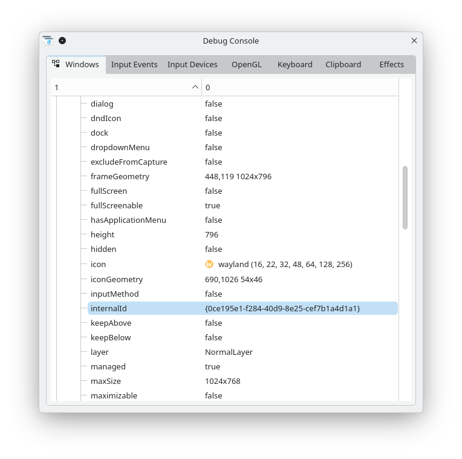

# Step 1.5c.5d Increment 1 — native-Wayland SDL Gate A identity evidence

**Test date:** 2026-11-06, America/New_York  
**Native operator:** maintainer, local Konsole on `q552u01` in a Plasma Wayland session; **not SSH**  
**Project:** `joetoo-ai/workspace/projects/joetoo-kwin`  
**Branch/checkpoint from the preceding synchronized candidate:** `task/joetoo-kwin-step1.5c5d-managed-rdp-implementation`, `5244949` (verify actual checkout when recording/publishing)  
**RDP endpoint:** `raspiubuntu401.brendler:3389`, username `joe` (no password in shell invocation)  
**Procedure:** development launcher, desktop 1 / slot 2; `--rdp-registration-timeout-ms 300000`  
**Disposition:** **Gate A — PASS for exact native-Wayland viewer identity and live backend evidence, subject to maintainer recording.** No placement was requested. Not a full Increment 1 or production-RDP acceptance.

This is a consolidated, **maintainer-observed** evidence record, derived from the actual Konsole A/B transcript, KWin Debug Console screenshot and private FreeRDP log excerpt provided to the review. It supplements the [earlier first positive native-registration report](step1.5c5d-native-wayland-sdl-registration-evidence-2026-11-06.md). The unredacted child log is **not** included in this repository artifact.

## 1. Preparation, control state and command

In Konsole A, `XDG_SESSION_TYPE=wayland`, OpenRC user service `joetoo-kwind` reported **started**, and `./tools/joetoo-kwind-install-poc --check` reported all **ten installed components Current**. No restart was needed for this test.

The maintainer copied the public server certificate and independently obtained `openssl verify ... -purpose sslserver -verify_hostname raspiubuntu401.brendler` → **`/tmp/raspiubuntu401.brendler.crt: OK` on q552u01**. This is a client CA/hostname preflight, *not* an explicit native SDL `/cert:deny` test. An SSH host-key change notice was encountered during `scp`; the maintainer attributed it to having rebuilt `raspiubuntu401`, which generated new SSH host keys. This is a separate SSH trust issue, not SDL registration evidence.

Pre-launch, Konsole B's broker query returned:

```json
{"observation":{"observed_count":4,"revision":14,"source":"1794021966363-rt2wh9eypde","synchronized":true},"placement_transaction":{"id":null,"state":"IDLE"},"managed_count":0,"request_counts":{"ambiguous":0,"failed":0,"pending":0,"running":0,"succeeded":0,"timeout":0}}
```

`ListManaged` returned `{"count":0,"windows":[]}`.

Konsole A invoked:

```bash
python3 tools/joetoo-sdl-registration-launch.py \
    raspiubuntu401.brendler joe \
    --desktop 1 --slot 2 --rdp-registration-timeout-ms 300000
# End of commands

```

## 2. Launcher identity and positive result

The launcher printed the following actual structured values:

```json
{"evidence_directory":"/tmp/joetoo-sdl-registration-sa569h4x","placement":"not_requested"}
{"child_pid":914978,"child_start":9791742,"request_id":"5976103a7320411d902286375414ab96","placement":"not_requested","remote_session":"unverified"}
{"managed_id":"win-001","placement":"not_requested","protocol":1,"reason":"registered","remote_session":"unverified","request_id":"5976103a7320411d902286375414ab96","state":"registered","window_uuid":"0ce195e1-f284-40d9-8e25-cef7b1a4d1a1"}
```

While the viewer remained alive, independent Konsole B checks returned:

| Evidence | Actual result |
| --- | --- |
| Live `ps -o pid,ppid,stat,comm -p 914978` | `914978 914977 Sl+ sdl-freerdp` |
| `/proc/914978/exe` | `/usr/bin/sdl-freerdp` |
| `/proc/914978/fd/1` | `/tmp/joetoo-sdl-registration-sa569h4x/stdout.log` |
| Independent installed `BackendEvidence.read_backend()` | `{"observed_backend":"wayland"}` |
| `GetManaged win-001` | `state=FOUND`, `presence=present`, `placement=not_requested` |
| Observed PID and application | `914978`, `com.freerdp.client.sdl3` |
| Intended desktop/slot | `1` / `2` |
| Broker title marker | `joetoo-rdp-cff3f9b19d8669b0f31f24c95f885019216fda56833ecaad26d686d1bc7c9db9` |
| Broker's exact `window_uuid` | `0ce195e1-f284-40d9-8e25-cef7b1a4d1a1` |

The PID 914978 and application identity agree with the actual process. PPID 914977 is observed; the parent command was not separately captured by `ps`, although the broker's successful registration enforces its independently implemented child-provenance rules.

The private stdout log starts with a matching PID-tagged SDL line, **while the child was active and before it registered**:

```text
[914978:000df622] [DEBUG][com.freerdp.client.SDL] - [main]: client is using backend 'wayland'
```

The line is reproduced as a short diagnostic excerpt, not the entire private log. The live `BackendEvidence` reader also returned `wayland`, closing the earlier timely-flush qualification **for this tested positive run**. The combined stdout/stderr stream may interleave lines; textual ordering in the retained file is not assumed to be a reliable global event clock.

## 3. Independent KWin UUID and geometry match

The maintainer opened KWin's Debug Console while the SDL viewer was alive and supplied this screenshot:



- KWin Debug Console `internalId`: `{0ce195e1-f284-40d9-8e25-cef7b1a4d1a1}`.
- Broker's `GetManaged win-001` `window_uuid`: `0ce195e1-f284-40d9-8e25-cef7b1a4d1a1`.
- **Exact UUID match**, with KWin's curly braces only a display-format difference.
- KWin Debug Console `frameGeometry`: **448,119 1024×796**, matching broker observation `x=448`, `y=119`, `width=1024`, `height=796`.
- KWin Debug Console also showed `managed=true`, `layer=NormalLayer`, `dialog=false`, `fullScreen=false`; consistent with a normal Wayland viewer, rather than a credentials dialog.

Screenshot SHA-256: `1375f5378118e8614f2c150bfa112f2a3816087632e6321897309951a8512258`. The screenshot's UUID text is not selectable; the supplied screenshot itself is the independent visual readback.

**Placement boundary:** In the pre-launch and live broker snapshots, `placement_transaction={id:null,state:"IDLE"}`; the registered entry reports `placement="not_requested"`. Ordinary SDL/KWin movement, resize or activation events are **not** broker placement operations. Independent before/after focus and whole-stack snapshots were **not** collected, so do not claim a complete focus/stack audit from this run.

## 4. After window closure

Konsole A ultimately reported:

```json
{"child_exit":131,"registration":"registered","remote_session":"unverified","placement":"not_requested"}
```

The final Konsole B `ps` output showed a header only: child PID **914978 was gone**. Broker verification continued to show:

- Same synchronized observation source `1794021966363-rt2wh9eypde`, with observation count returning to **4** and revision advancing to **760**.
- `request_counts`: `succeeded=1`, `pending=0`, `running=0`, `failed=0`, `timeout=0`, `ambiguous=0`.
- `managed_count=1` and `placement_transaction={id:null,state:"IDLE"}`.
- `GetManaged win-001`: `state=FOUND`, same UUID/PID/marker/request ID, now **`presence="missing"`**, correctly describing a retained historical registration rather than a live viewer.

### Exit code 131 — evidence-based interpretation

The private log at `/tmp/joetoo-sdl-registration-sa569h4x/stdout.log` contains, at **22:42:00.078 local log time**, these messages from PID 914978:

```text
SDL_EVENT_WINDOW_CLOSE_REQUESTED
Window closed, terminating RDP session...
ERRCONNECT_CONNECT_CANCELLED [0x0002000B]
Network disconnect!
```

The source-level FreeRDP SDL enum labels process exit **131** as `CONN_FAILED`; however **the observed sequence first records a window-close request**, immediately followed by session termination and cancellation. This is **strong evidence for a close-triggered cancellation**, not evidence of an unexplained spontaneous connection failure. The specific exit-code mapping path in the installed 3.32.1 build was not traced; do not reclassify 131 as a clean RDP transport success, and do not treat it as invalidating the prior successful **window registration**. FreeRDP reference: <https://pub.freerdp.com/api/SDL3_2sdl__utils_8hpp_source.html>.

The private log also shows a GNOME RDP server-redirection PDU, SDL window lifecycle events and normal SDL display events. The build warns that AAD support is disabled; this is not a TLS certificate-validation result. **Raw log retained privately**; it may include operational details and must not be committed or published as-is.

## 5. Acceptance mapping and scope limits

| Increment 1 question | Finding |
| --- | --- |
| Native-Wayland SDL `wayland` backend? | **PASS**, actual live evidence reader + PID-matching log |
| Direct child/process and log-FD correspondence? | **PASS for observed native process/FD and broker registration**; PPID observed |
| KWin Debug Console UUID equals broker registered UUID? | **PASS**, exact independent screenshot match |
| Correct live normal viewer vs unmarked dialog? | **PASS for this run**, KWin properties and registered application/marker |
| Registration without broker placement? | **PASS**, `not_requested` and `IDLE`; no placement request shown |
| Window disappearance and child reaping? | **PASS for observed run**, process absent and record marked `missing` |
| Server authentication, certificate pinning, production transport policy? | **Outside this registration gate**; separate PKI/security validation |
| Full Increment 1 failure/coexistence matrix? | **NOT YET COMPLETE** |

Other evidence already available: [first native positive test and post-exit registry](step1.5c5d-native-wayland-sdl-registration-evidence-2026-11-06.md); maintainer-reported **NLA-dialog Cancel PASS** (child 884517, terminal `child_identity_rejected`, no managed window, no child remaining, `IDLE` placement and no pending/running requests), from a separate broker baseline after a restart. That cancellation gate does *not* prove preservation of the older `win-001` record, which was absent from its new baseline.

**Outstanding for Increment 1:** bounded refused/unreachable endpoint behavior, wrong-password behavior if approved without account-lockout risk, operator Ctrl-C pending cleanup, unrelated viewer/coexistence and record isolation, and a deliberate scope/coverage review of any remaining native identity/placement observations. Headless adversarial scenarios need not all be reproduced natively if already covered by reviewed tests. Later X11, placement, configured `-o` recipe, production TLS/NLA policy and publication remain separate gates.

## 6. Next decision, not blanket authorization

The next sensible native gate is **one controlled connection-refused test**, preferably against a verified unused local TCP port on `q552u01`; expect no registered viewer, no active transaction, no leaked SDL child and `IDLE` placement. Choose the exact endpoint, baseline and expected terminal reason before executing. Do **not** assume the earlier restart/empty registry is a permanent baseline or clear records by restarting the broker. A passed Gate A does not grant Codex permission for native execution or further implementation.

Preserve this Markdown record and its screenshot in the task directory; keep the private raw stdout log only in controlled local storage. Update the active `HANDOFF.md` to point here, without inserting the raw log or an iteration transcript.
