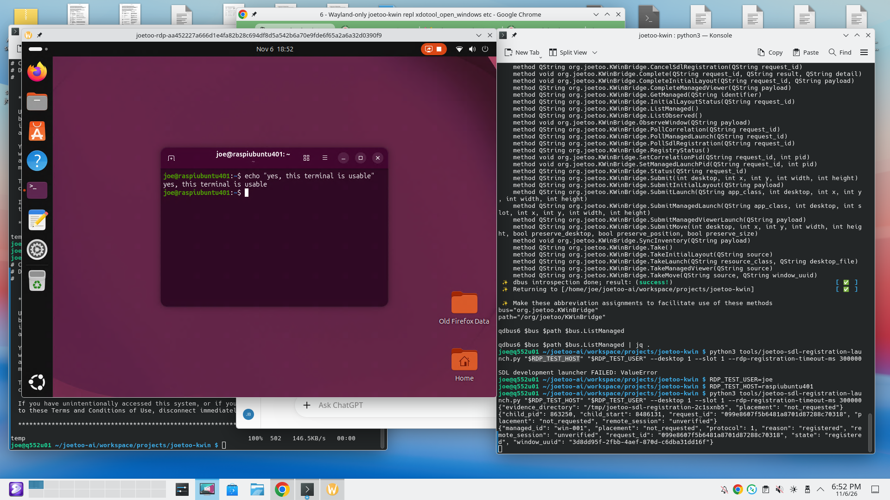

# Step 1.5c.5d, Increment 1 — native-Wayland SDL registration evidence

**Date:** 2026-11-06 (America/New_York)  
**Native test host:** `q552u01`, local non-root Plasma/Wayland Konsole (not SSH)  
**RDP target:** `raspiubuntu401`, username `joe`, development launch to default port `3389`  
**Repository:** `JosephBrendler/joetoo-ai`, `workspace/projects/joetoo-kwin`  
**Branch:** `task/joetoo-kwin-step1.5c5d-managed-rdp-implementation`  
**Tested checkout:** `5244949` (fast-forwarded on `q552u01` from `2bb9c74`)  
**Status:** **First positive native SDL registration demonstrated.** Full Increment 1 acceptance and remaining negative/lifecycle gates are **not** claimed.

This is a maintainer-observed evidence record, compiled from the maintainer's terminal transcripts and the supplied screenshot. It does not claim that Codex performed native graphical testing, nor does it replace the interface contract or grant new operational authority.

## 1. Scope of the observed run

The bounded test was intended to verify a direct SDL FreeRDP child on native Wayland, through one persistent local D-Bus connection, following:

`BeginSdlRegistration` → launch direct SDL child → `BindSdlRegistration` (real child PID and private regular-log FD) → `PollSdlRegistration` → exact KWin viewer UUID registration.

**Registration only:** no desktop/geometry/stacking/focus placement operation was requested. The registered window's actual on-screen location and the intended desktop/slot are separate facts. No production `-o` recipe, TLS/NLA or certificate-trust acceptance is inferred.

## 2. Source/installation and independent regression evidence

### 2.1 Published branch and q552u01 synchronization

The maintainer ran `git pull --ff-only` on `q552u01`. It reported:

```text
From github.com:JosephBrendler/joetoo-ai
   2bb9c74..5244949  task/joetoo-kwin-step1.5c5d-managed-rdp-implementation -> origin/task/joetoo-kwin-step1.5c5d-managed-rdp-implementation
Updating 2bb9c74..5244949
Fast-forward
```

The update added `tools/joetoo-sdl-registration-launch.py` and `tests/test_rdp_development_launcher.py`; updated the private adapter, HANDOFF, SDL interface contract and maintainer-owned restart wrapper. This is a task-branch checkpoint, **not** a merge into `main`.

### 2.2 gmki91 maintainer validation

- Focused Python: **178 PASS**, 11.837 s (`test_openrc_user_setup`, `test_rdp_broker`, `test_rdp_launch`, `test_rdp_development_launcher`).
- Full Python: **613 PASS**, 92.105 s, via `./tools/restart_joetoo-kwind test`.
- JavaScript: **99 PASS**, with no failures or skips.
- Installer update/check, OpenRC service start, and four SDL D-Bus method introspections: **PASS**.
- `validate_scripts tools/ -l`: newly added launcher and restart wrapper reported OK; files skipped for missing shebang are not evidence of validation of those individual files.
- Review showed the intended six-file working-tree candidate at that stage (four modified files plus two new files), before the published synchronization checkpoint.

### 2.3 q552u01 maintainer validation, in local Wayland Konsole

- Focused Python: **178 PASS**, 17.307 s.
- Full Python via `./tools/restart_joetoo-kwind test`: **613 PASS**, 88.435 s.
- JavaScript: **99 PASS**, no failures or skips.
- Installer update: **PASS**, including archiving the prior installed SDL adapter and installing the ten managed components.
- Installer `--check`: **PASS**, reporting the SDL adapter and all other managed components Current.
- OpenRC service start and live D-Bus introspection in the corrected wrapper: **PASS**. The four methods are `BeginSdlRegistration`, `BindSdlRegistration`, `PollSdlRegistration`, and `CancelSdlRegistration`; Bind was exposed with signature `sih → s`.
- Earlier same-session checks showed `XDG_SESSION_TYPE=wayland` and a populated Unix `DBUS_SESSION_BUS_ADDRESS`; `rc-service -U joetoo-kwind status` reported started.

## 3. Native test invocation and returned evidence

The first invocation used unset/empty `RDP_TEST_HOST` and `RDP_TEST_USER` shell variables and returned:

```text
SDL development launcher FAILED: ValueError
```

No broker/SDL outcome is claimed from that input-validation failure. The maintainer then assigned:

```bash
RDP_TEST_USER=joe
RDP_TEST_HOST=raspiubuntu401
python3 tools/joetoo-sdl-registration-launch.py "$RDP_TEST_HOST" "$RDP_TEST_USER" --desktop 1 --slot 1 --rdp-registration-timeout-ms 300000
# End of commands

```

The subsequent invocation returned these lines, in order (verbatim structured values):

```json
{"evidence_directory": "/tmp/joetoo-sdl-registration-2c1sxnb5", "placement": "not_requested"}
{"child_pid": 863250, "child_start": 8486131, "request_id": "099e8607f5b6481a8701d87288c70318", "placement": "not_requested", "remote_session": "unverified"}
{"managed_id": "win-001", "placement": "not_requested", "protocol": 1, "reason": "registered", "remote_session": "unverified", "request_id": "099e8607f5b6481a8701d87288c70318", "state": "registered", "window_uuid": "3d8dd95f-2fbb-4aef-870d-c6dba31dd16f"}
{"child_exit": 2, "registration": "registered", "remote_session": "unverified", "placement": "not_requested"}
```

**Positive native observation:** the launcher reported a real child PID and start identity, and the broker returned `registered` with an exact UUID and managed ID. The source implementation requires evidence of the native `wayland` SDL backend before the broker's positive registration result; thus timely accepted backend evidence is strongly supported by this live registration. The private raw log/backend line was not independently pasted into this record.

**Distinct later outcome:** the launcher reported `child_exit=2` after registration. The numerical exit code is preserved as observed; the specific remote/application exit cause is **not independently determined** by this record. No child reaping audit or raw log review is included. This was the assessment before the maintainer supplied the logout clarification recorded in §4.5 below.

### 3.1 Screenshot of the native session



Supplied screenshot: **2026-11-06 at approximately 18:52**, resolution **1920 × 1080**. The window title contains the broker-issued `joetoo-rdp-...` token. The SDL FreeRDP window shows the remote Ubuntu graphical desktop and a terminal in `raspiubuntu401`; the terminal displays a successful local `echo` of `yes, this terminal is usable`. This is direct visual evidence of a usable remote graphical session, **not** proof of a production security/certificate policy or of the broker's transport-status field. The image does not display the independent KWin Debug Console's UUID readback.

Screenshot SHA-256: `0b0bb714b7595cb0bc4971bdf0839d22dc2e397bdc46589e69c43426fbd0e167`.

## 4. Post-exit read-only broker verification

The maintainer ran these queries on q552u01 after the launcher exited:

```bash
bus=org.joetoo.KWinBridge
path=/org/joetoo/KWinBridge
qdbus6 "$bus" "$path" "$bus.RegistryStatus" | jq '{observation, placement_transaction, managed_count, request_count, request_counts}'
qdbus6 "$bus" "$path" "$bus.ListManaged" | jq .
qdbus6 "$bus" "$path" "$bus.GetManaged" win-001 | jq .
# End of commands

```

### 4.1 RegistryStatus (observed)

```json
{
  "observation": {
    "observed_count": 4,
    "revision": 273,
    "source": "1794008805595-74in7jfivf862d6dfi5yaa",
    "synchronized": true
  },
  "placement_transaction": {"id": null, "state": "IDLE"},
  "managed_count": 1,
  "request_count": 1,
  "request_counts": {
    "ambiguous": 0,
    "failed": 0,
    "pending": 0,
    "running": 0,
    "succeeded": 1,
    "timeout": 0
  }
}
```

### 4.2 ListManaged (observed)

```json
{
  "count": 1,
  "windows": [
    {
      "connection": "not_attempted",
      "intended": {"desktop": 1, "slot": 1},
      "managed_id": "win-001",
      "placement": "not_requested",
      "presence": "missing",
      "request_id": "099e8607f5b6481a8701d87288c70318",
      "run_id": null,
      "window_uuid": "3d8dd95f-2fbb-4aef-870d-c6dba31dd16f"
    }
  ]
}
```

### 4.3 GetManaged win-001 (observed)

```json
{
  "state": "FOUND",
  "window": {
    "connection": "not_attempted",
    "intended": {"desktop": 1, "slot": 1},
    "managed_id": "win-001",
    "observation": {
      "caption": "joetoo-rdp-aa452227a666d1e4fa82b28c694df8d5a542b6a70e9fde6f65a2a6a32d0390f9",
      "desktop_file": "com.freerdp.client.sdl3",
      "desktops": [1],
      "geometry": {
        "height": 796,
        "width": 1024,
        "x": 47.41029114406046,
        "y": 61.83082890240651
      },
      "on_all_desktops": false,
      "pid": 863250,
      "resource_class": "com.freerdp.client.sdl3"
    },
    "placement": "not_requested",
    "presence": "missing",
    "request_id": "099e8607f5b6481a8701d87288c70318",
    "run_id": null,
    "window_uuid": "3d8dd95f-2fbb-4aef-870d-c6dba31dd16f"
  }
}
```

### 4.4 Assessment of post-exit state

- `succeeded=1`, `pending=0`, `running=0`, and `placement_transaction=IDLE` are consistent with a completed registration transaction and no active placement request.
- `managed_count=1` with `presence="missing"` means the broker **retains the managed registration record** but recognizes the viewer window is no longer present. It is **not** evidence that a live viewer or active request remains.
- `GetManaged win-001` resolves to the exact originally registered UUID, request ID and child PID, with an SDL desktop-file/resource-class identity and the same launch title marker visible in the supplied screenshot.
- `intended.desktop=1` and `intended.slot=1` describe the requested intended allocation; they do not imply actual placement. The historical KWin observation happened to list desktop `[1]` and geometry 1024×796. No before/after independent geometry/focus/stack readback is supplied.
- `connection="not_attempted"` and `remote_session="unverified"` are transport-status/reporting boundaries of the development registry/launcher; they do **not** negate the visually usable remote GNOME desktop, and neither is a production connectivity/security attestation.
- The observation source is synchronized in this final snapshot. A paired baseline source ID spanning this particular native run was not provided; do **not** claim its unchanged identity solely from this snapshot.

### 4.5 Codex source review and subsequent maintainer clarification

Codex reviewed this report, the actual screenshot (whose SHA-256 matches §3.1),
and the launcher, broker, registry and interface contract at `5244949`. The
assessment supports **first positive native-Wayland registration PASS**, preserving
the previously accepted Begin/Cancel smoke gate. The published registration path
requires successful child/log-FD binding, live process identity, accepted
PID-matching `wayland` backend evidence and qualifying exact-marker UUID lifecycle
before returning `registered`. Timely backend evidence therefore succeeded in
this run; no buffering remedy is justified by this result. Independent live
Debug Console/process/FD readbacks and native negative-path checks remain separate
acceptance evidence. Full Increment 1 acceptance is still pending.

**Maintainer clarification, supplied after that review:** the maintainer had
already logged out of the remote Ubuntu session before running the final
`ListManaged` and `RegistryStatus` queries.

**Reconciled assessment:** the observed logout, `child_exit=2` and retained
`presence="missing"` registration form a consistent lifecycle. In the inspected
FreeRDP 3.32.1 source, `client/SDL/SDL3/sdl_utils.hpp` defines `LOGOFF = 2`, and
`sdl_context.cpp` treats LOGOFF as an ordinary cleanup outcome. Logout ended the
viewer; its subsequent absence explains the missing-window observation. There
is **no unexplained failure indicated by these results**. The earlier exit-cause
qualification in §3 concerned the then-missing operator-action detail; that
question is now resolved by the maintainer's confirmation. A raw-log or independent
process/FD cleanup audit was not performed and is not claimed.

The registry preserves the original UUID and last observation after disappearance;
it does not retain a live viewer or silently adopt a successor. The launcher's
`child_exit` field is the child's application status, separate from its successful
registration result and from the launcher's own shell exit status. The latter was
not separately captured in the supplied transcript.

## 5. Bounded result and remaining acceptance work

### Demonstrated

1. The new persistent development launcher reached a live real SDL FreeRDP child and positive broker registration on `q552u01`'s native Wayland session.
2. One exact request ID (`099e8607f5b6481a8701d87288c70318`), managed ID (`win-001`) and UUID (`3d8dd95f-2fbb-4aef-870d-c6dba31dd16f`) are consistently reported in the live result and post-exit registry history.
3. The broker's registration path reported `placement="not_requested"`; post-exit placement transaction remained `IDLE`.
4. The screenshot shows an interactive Ubuntu session with a working remote terminal; the screenshot title marker agrees with the recorded KWin caption.
5. Post-exit broker queries remained available, synchronized and free of pending/running requests, with the registered record explicitly `presence="missing"`.
6. Independent regression totals on both gmki91 and q552u01: 178 focused Python, 613 full Python, 99 JavaScript tests PASS.

### Not independently established / still required

- Independent live KWin Debug Console UUID comparison while the viewer is present; direct live readback of PID/application/UUID and pre/post geometry/stack/focus.
- Terminal-B `ps`/`readlink` evidence for `/proc/<child>/exe` and stdout inode while alive, and independent bounded `BackendEvidence.read_backend()` output. The successful broker registration strongly supports these contract checks but does not replace their separate diagnostic record.
- Independent process/FD cleanup audit was not supplied. The earlier question about the operator action and `child_exit=2` is resolved by the logout clarification in §4.5; it is not an unexplained-failure blocker.
- NLA cancelled/wrong-credential, refused-endpoint, pending Ctrl-C, competing/preexisting viewer and other bounded negative/coexistence cases; no automatic rerun of these cases is authorized by this file.
- Production TLS/NLA and certificate trust, X11 viewer identity, placement, configured `-o` recipes and full Increment 1 acceptance.

**Disposition:** **First native positive registration PASS; supporting post-exit registry verification PASS.** Maintainer has not yet declared Increment 1 accepted in the supplied record. The next decision is a source-grounded review of the outstanding evidence and a separately bounded next native test, not automatic progression into X11 or placement.

**Related documents:** [Current HANDOFF](HANDOFF.md), [SDL development interface contract, §7](step1.5c5d-sdl-interface-contract.md), [Implementation scope, §5A](Step1.5c5_implementation_scope.md).
